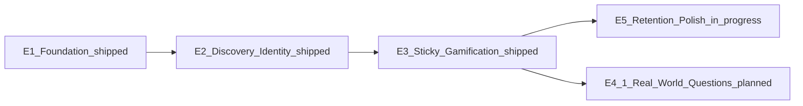

# Problem Bank — AI agent handoff

**Last updated:** 2026-09-13  
**Repository:** `maths_generator/physics-problem-bank` (GitHub: `kingdavidek/physics-problem-bank`)  
**Audience:** The next AI agent (or human) continuing product work  

Start here. Read the documents in the order below before changing behaviour that touches auth, grading, sessions, or the database.

---

## 1. Current product status

| Area | Status |
|------|--------|
| **Auto-correct (Phases A/B)** | Complete (GCSE CS + Maths; Python via client Pyodide) |
| **Phase G learning (G1–G7)** | Shipped (weak topics → exam revision planner) |
| **Solid-draft security bar** | Done (2026-08-01). See `docs/SOLID_DRAFT_SECURITY.md` |
| **Security + UK GDPR compliance** | **S0–S3 shipped (2026-08-26)** — `docs/SECURITY_AND_GDPR.md`. S3 is the keep-it-true calendar: **`docs/CADENCE.md`**. **Operator S0.1** (ICO fee, live contact, prune cron) is written for David in **`docs/OPERATOR_LAUNCH.md`** — do that at public HTTPS / M5, not during product tracks. |
| **Mobile polish (app-like PWA)** | **Done (M0–M4)** — foundation, practice UX, app chrome, lessons/diagrams, PWA polish + device QA. **M5–M7** HTTPS → TWA → Play Android when a production URL exists — see `docs/MOBILE.md` |
| **Phase U (UI redesign)** | **U closed.** Dark mode **D0–D3 shipped** (shell, status chips, diagrams, settings toggle). Cache: `pb-v79`. Spec: `docs/UI_REDESIGN.md` §15. **Follow-up:** settings switches may not persist (see §1.1). |
| **Engagement roadmap (E1–E3)** | **E1–E3 shipped** (assist mock smoke, `@problem_bot` QOTD card, FTS lesson search, emoji/colour avatars, study buddy, friend quiz-accuracy leaderboard). Visual tokens: `docs/ENGAGEMENT_VISUAL.md` |
| **G8 teacher / class mode** | Designed; decisions locked 2026-08-30. **Phases 0–6 complete** (teacher enable, classes, join, handle invites, roster, teacher-only remove, T0–T2 dashboards, frozen set-work, audit log, CSV, verification). `docs/G8_TEACHER_HANDOFF.md`, `docs/G8_TEACHER_REVIEW_RUBRIC.md`, `docs/POTENTIAL_FUTURE_FUNCTIONALITY.md` §2 |
| **Real-world question style (E4.1)** | **Planned, fully specified** — `docs/REAL_WORLD_QUESTIONS.md`. Third generator mode (`real_world`) across percentages, ratio, compound measures |
| **European School Integrated Science S1–S3** | **ES10 shipped** — full curriculum (46 modules, six IBL tracks, whole-suite QA). **Lesson-improvement track complete (Stages 0–7).** **Practice generator complete (Phases 0–7)** (`docs/EURSC_GENERATOR_HANDOFF.md`, `docs/EURSC_GENERATOR_REVIEW_RUBRIC.md`, canvas `eursc-generator-question-plan.canvas.tsx`). Curriculum: `docs/EUROPEAN_SCHOOL_SCIENCE.md`. **Advanced Practice modes:** operational **pilot signed 2026-09-02 (scope A)**; **S1 wave complete**; **S1–S3 waves complete and whole-matrix audit smoke green (2026-09-13)** — `scripts/test_es_advanced_matrix_audit_smoke.py` parses the matrix in the contract doc and verifies 46 slugs / 243 cells / 729 variants / 33 fail-closed cells. Content-complete; David closes the track after a live visual pass. Contract: `docs/EURSC_ADVANCED_QUESTIONS.md` |
| **Guide & celebration (E6 / Phase A)** | **A1–A6 + B shipped** (origin, badge/streak/first-correct/lesson-complete, five tours, `guide_json` persist + Replay intro, CSS streak fire, overlay wink/nod/shake/tap). Spec: `docs/ANIMATION_ONBOARDING.md`. Not the E4.2 mascot farm. |
| **Mascot motion + onboarding (E7)** | **Planned, decisions frozen (2026-09-20)** — CSS budget raised 226→240KB total / 199→210KB core; no third-party animation library (Lottie/GSAP/Rive stay banned); cosmetics layer on the same rig instead of a second character, automatic/content-facing first. **Phases 1 through 3 built, reviewed, committed and pushed on the live repo (2026-09-22 through 2026-09-26, including a small Phase 2 cache-bust hotfix); CI green for both. Phase 4 (ambient touches — page transition/View Transitions, combined button spring+edge press, confetti shapes/sparkle, streak-ring peek, sleeping-Zorp offline page, install-banner wave, 5 empty states) built and reviewed 2026-09-26, post-review fixes applied. Phase 5 (motion preference + polish — final phase) built 2026-09-26 — not yet committed/pushed, awaiting David's sign-off.** Spec: `docs/MASCOT_MOTION_AND_ONBOARDING.md`. |
| **Zorp expressions, poses and turning (E8)** | **D1–D5 confirmed 2026-09-29 (all recommendations).** Phase 0 (feature gate Q1–Q3 no / Q4 yes; `/styleguide#zorp-gallery` skeleton; `scripts/test_zorp_expression_smoke.py` baseline ledger; dev-only `scripts/zorp_gallery_snapshot.py`; baseline contact sheets) built 2026-09-29, committed upstream as 17b8b38. Phase 1 (expression engine, parts library, legacy parity, 11 new faces) committed upstream as a951fd5. Phase 2 (full vocabulary: 30 presets, fx layer, animated part swaps, safeguarding tests) built 2026-09-29. Phase 3 (views, mirror wrapper, arm pivot groups, `pbZorp.turn` pinch-turn, `side-point`) built 2026-09-29. **Phase 4 (pose library, arm shapes, beat engine, fist-pump jump; new `static/js/zorp-poses.js`) built 2026-09-30. Phase 5 (wiring into app moments: prompts, reactions, guide, welcome, empty states) built 2026-09-30. Phase 7 (polish, idle life, performance pass, docs) built 2026-10-01; Phase 6 (pose-kit parity, static-still helper) is NOT built. Phases 4, 5 and 7 are not committed, awaiting David's review.** Spec: `docs/ZORP_EXPRESSIVENESS.md`. |
| **Zorp charm (E9)** | **Planned 2026-10-04; D1 to D9 confirmed (D6 = B: a new `zorp_sound` setting). Phase 0 built 2026-10-04** (feature gate Q1 yes, Q2 no, Q3 no, Q4 yes; copy inventory and report-mode voice lint; ledger baseline; `e9-baseline` snapshots). D10 and D11 (stay label "Keep learning"; per-line reading limit only from 8 words) confirmed later the same day. **Phase 1 built 2026-10-04** (talking mouth in the Guide, corner bubble and welcome; new `zorp-talk.js`), awaiting review. **Phase 2 built 2026-10-04** (soft body and secondary motion in `zorp-poses.js`; belly dropped), awaiting review. **Phase 3 built 2026-10-05** (voice guide `docs/ZORP_CHARM.md` 3.3.6, copy pass on 26 lines, enforcing `scripts/test_zorp_voice_smoke.py`), awaiting David's review. **Phase 4 built 2026-10-06** (`zorp_sound` setting, off by default; synthesised cues in `sound.js`), awaiting review. **Phase 5 built 2026-10-06** (evaluation kit `docs/ZORP_EVALUATION.md`, printable `docs/zorp_evaluation_print.html`, the styleguide showreel; the class session has not happened, so the results are blank and no tuning is applied): E9 built; evaluation pending. Spec: `docs/ZORP_CHARM.md`. |
| **Engagement E5 (retention polish)** | **E5.1–E5.6 shipped.** Remaining **E5.7** web push — blocked until `docs/MOBILE.md` M5. Spec: `docs/ENGAGEMENT_E5.md` |
| **Engagement stretch (E4.2–E4.3)** | Long-term — see `docs/POTENTIAL_FUTURE_FUNCTIONALITY.md` §3.0 (mascot farm, Desmos-class graphs) |
| **Git tip (post-hardening)** | Harden commit on `main`; history purged of `data/quicktest.db` |

**Do not regress solid-draft security** when shipping engagement or mobile work. Prefer extending existing models (QOTD, social feed, gamification, search) over rebuilding them.

### 1.1 Known issues (later)

**Settings form toggles may not persist after Save.** Reproduced 2026-08-25 on `/profile/settings` (sound switch: turn on → Save → still off). Backend save works when `sound_enabled=1` is in the POST (`update_profile_settings` in `models/social.py`); the failure is the **switch UI** — the hidden checkbox often is not checked when the form submits. A debug pass that restyled the switch (`absolute` / overlay / JS button) made layout worse (giant blue track, missing pills) and was **reverted** to commit `df39094`. Do not retry overlay/absolute switch CSS. Next attempt: keep native checkbox semantics, a 44×26 in-flow hit target, no `position: absolute; inset: 0` on `.switch`, and verify the POST includes `sound_enabled` before changing chrome.

---

## 2. Reading order (required)

| Order | Document | Why |
|-------|----------|-----|
| **1** | **This file** (`docs/AI_HANDOFF.md`) | Status, reading order, invariants, engagement E1–E3 |
| **2** | `docs/ARCHITECTURE.md` | Product + system architecture, features, layout |
| **2b** | `docs/COMPLEX_MECHANISMS.md` | Deep dive: grading, generator queues, Phase G (Flask/JS/CSS roles) |
| **2c** | `docs/MOBILE.md` | Mobile polish (M0–M4) + Play Android via TWA (M5–M7) |
| **3** | `docs/SOLID_DRAFT_SECURITY.md` | Critical/high fixes just shipped; **do not regress** |
| **3b** | `docs/SECURITY_AND_GDPR.md` | S0–S3 plan. **S0–S3 are done** (S3 = calendar, not a feature). Read before touching auth, personal data, defaults, or anything that leaves the server. Calendar: `docs/CADENCE.md`. Drafts: `docs/DPIA.md`, `docs/ROPA.md`, `docs/SUBPROCESSORS.md`. Runbooks: `docs/INCIDENT_RESPONSE.md`, `docs/DATA_RIGHTS.md`, `docs/MODERATION.md`, `docs/ZAP.md` |
| **4** | `docs/POTENTIAL_FUTURE_FUNCTIONALITY.md` | G8 design (locked §2.2) + engagement E4 + other future ideas |
| **5** | `docs/API.md` | REST `/api/v1/*` contracts when touching APIs |
| **6** | `docs/DEPLOY.md` | Env, HTTPS, backups, smoke, production checklist |
| *at public launch / M5* | **`docs/OPERATOR_LAUNCH.md`** | **David’s** ICO / privacy-inbox / prune-cron checklist. Surface this when starting production HTTPS; skip it during E4.1, UI, etc. |
| *before starting E4.1* | `docs/REAL_WORLD_QUESTIONS.md` | Step-by-step plan for the real-world generator mode |
| *before European School content* | `docs/EUROPEAN_SCHOOL_SCIENCE.md` | Full curriculum plan (46 modules). **ES10 shipped** — curriculum track closed |
| *European School lesson-clarity track* | `docs/EURSC_LESSON_IMPROVEMENT_HANDOFF.md`, `docs/EURSC_LESSON_REVIEW_RUBRIC.md` | **Complete** (Stages 0–7) |
| *European School Practice generator* | `docs/EURSC_GENERATOR_HANDOFF.md`, `docs/EURSC_GENERATOR_REVIEW_RUBRIC.md`, canvas `eursc-generator-question-plan.canvas.tsx` | **Complete** (Phases 0–7) |
| *European School advanced Practice modes* | `docs/EURSC_ADVANCED_QUESTIONS.md` | **Operational pilot signed 2026-09-02 (scope A).** **S1–S3 waves complete; whole-matrix audit smoke green (2026-09-13).** Track is content-complete — David to close after a live visual pass. |
| *before starting G8 teacher / class* | `docs/G8_TEACHER_HANDOFF.md`, `docs/G8_TEACHER_REVIEW_RUBRIC.md`, `docs/POTENTIAL_FUTURE_FUNCTIONALITY.md` §2, `docs/DPIA.md` §9 | **Complete (Phases 0–6).** Do not reopen §2.2. No Leave. No T3 to teachers. |
| *redoing ES0 only* | `docs/ES0_HANDOFF.md` | Phase ES0 platform enablement; sync `main` first |
| *before starting E6 / Guide* | `docs/ANIMATION_ONBOARDING.md` | Origin story, section tours, badge/streak celebration; includes the next-agent prompt |
| *before starting E5* | `docs/ENGAGEMENT_E5.md` | Step-by-step plan for buddy v0.5, badges, QOTD week, streak freeze, avatar unlocks |
| *as needed* | `docs/EMAIL_SETUP.md` | Weekly digest only |
| *as needed* | `docs/ENGAGEMENT_VISUAL.md` | Avatar / buddy colour and emoji tokens (after E1) |
| *as needed* | `.env.example` | Local secrets and feature flags |

Word (`.docx`) copies exist for key docs. **Markdown is the source of truth** for agents.

---

## 3. Hard invariants (do not break)

1. **Never** grade algebraic / quadratic-roots answers with bare `sympify()` on untrusted strings. Use `_safe_sympify` / allowlisted `parse_expr` only (`generators/shared/answer_checkers.py`).
2. **SymPy-backed `answer_type`s** (`algebraic`, `quadratic_roots`) require a **server session** problem for `POST /api/v1/problems/check` — no client-chosen type/raw fallback.
3. **MCQ correctness** comes from session `correct_answer`, never a client `correct` boolean.
4. **Saved problems** persist only the session-generated problem — never client-supplied HTML/JSON problem bodies.
5. **`SECRET_KEY`** must be non-default outside testing; use `PB_ALLOW_DEV_SECRET=1` only for local throwaway runs.
6. **Never commit** `data/*.db`, `*.bak`, or `.env`. Smoke tests use ephemeral DB (`PB_TESTING=1` / `PB_DB_PATH`).
7. **Do not set `PB_TESTING=1` in production** (disables rate limits and CSRF exemptions used by smoke).
8. Prefer **extending** `answer_checkers`, Phase G models, and `topic_registry` — do not rebuild them.
9. **Friend-only leaderboards** for learner competition (no global public ranking of minors) — safeguarding default for E3.
10. **Never send a handle, email, or user ID to an external AI provider.** Lesson assist may send lesson text and the student's typed question only, and only when explicitly enabled.
11. **No analytics, advertising, or third-party tracking.** The site needs no cookie-consent banner precisely because none exists; adding any requires a consent flow and a rewritten privacy notice in the same release.
12. **Anything that makes a child more visible to others defaults to off.** See `docs/SECURITY_AND_GDPR.md` §S0.3.
13. **Never store a raw IP address** where a keyed hash serves the same purpose (rate-limit and usage buckets are compared, never read back).
14. **Before any new feature**, answer the four questions in `docs/SECURITY_AND_GDPR.md` §6.1 (`python scripts/ops_cadence.py feature-gate`). Privacy / ROPA / DPIA / subprocessor edits ship in the same PR if any answer is yes.
15. **EURSC questions are direct.** Never hedge a stem, option or solution with course/model meta-phrases — "in this lesson", "in this S2 model", "in this course", "at S1 level", "of the order of", "the lesson says/names", "teaching set/figure". Pupils aged 11–15 should read one clear answer, not a hint that a more accurate answer exists. `scripts/test_es_direct_wording_smoke.py` enforces this across every EURSC topic and mode; safeguarding wording about "this quiz" / "the app" is allowed.
16. **EURSC MCQ distractors are plausible misconceptions**, not off-topic filler ("a class vote", "a stored diet file", "rank classmates", "eight planets" as an age). Wrong answers should be on-topic, clearly wrong for the tier, and similar in length and grammar to the correct option. Safeguarding items keep their meaning but their wrong options are realistic alternatives ("let the class vote", "keep a private list"). `scripts/test_es_distractor_quality_smoke.py` checks distinctness, retired filler phrases and length give-aways. The same two rules apply to lesson-page prose and inline Quick Checks (`templates/eursc_science_*_lesson.html`), where the correct letter must also be spread across A–D rather than always B; `scripts/test_es_template_quickcheck_smoke.py` enforces all of that.
17. Mascot motion lives in `zorp-motion.js` + `motion.css`; every clip needs a reduced-motion variant; never add a third-party animation library. Expressions and poses are data in `models/zorp_rig.py` plus art in `templates/partials/zorp_parts.html`; negative presets obey the `CONTEXT_MAP` valence rules (never in prompts, reactions, dismissals, idle life, autoplay or notifications). Idle life runs only at full motion, on screen and when nothing else is happening, and never changes the expression. The developer API summary is `docs/ZORP_EXPRESSIVENESS.md` section 10. Every line Zorp says follows the voice guide in `docs/ZORP_CHARM.md` section 3.3 (3.3.6 is the short version) and is enforced by `scripts/test_zorp_voice_smoke.py`: mark template copy with `data-zorp-voice`, and run `python scripts/test_zorp_voice_smoke.py --write` after any copy change. Talk and cues only at E9 moments (`docs/ZORP_CHARM.md` section 3.0): text first, then the mouth; sound on for new accounts since E10 (2026-11-08, existing accounts keep their setting) and always tap-gated (`zorp_sound`, a tap in the last 5 s, never on load, in a quiz, from idle or at reduced or off motion); evaluation is teacher-led, offline and anonymous (`docs/ZORP_EVALUATION.md`).

---

## 4. How to run locally

```powershell
# From repo root
copy .env.example .env   # set SECRET_KEY, or PB_ALLOW_DEV_SECRET=1 for local only
pip install -r requirements.txt
python app.py            # binds 127.0.0.1; FLASK_DEBUG=1 for debugger

# Full smoke suite (sets testing DB automatically via run_smoke_tests.py)
$env:PB_TESTING='1'
python scripts/run_smoke_tests.py
```

Security regression of interest: `scripts/test_sympy_security_smoke.py`.

Lesson assist (optional AI): set `LESSON_ASSIST_*` / provider keys in `.env` — see `.env.example` and E1.1 below.

WSGI / production entry: `from app import app as application` (see `docs/DEPLOY.md`). Prefer `app.py` over legacy `flask_app.py`.

---

## 5. Where code lives (cheat sheet)

| Concern | Primary location |
|---------|------------------|
| Routes, schema, API, web | `app.py` |
| Topic → generator map | `topic_registry.py` |
| Lesson metadata | `topics_data.py` |
| Grading | `generators/shared/answer_checkers.py`, `sql_checker.py` |
| Lesson AI assist | `generators/shared/lesson_assist.py`, `static/js/lesson-assist.js` |
| System bot / daily QOTD card | `models/bot.py`, feed template + `/api/v1/feed` `qotd_challenge` |
| Alien buddy | `models/buddy.py`, `static/js/study-buddy.js` (legacy `buddy.js`), `templates/partials/buddy.html` SVG mascot, `templates/base.html` embed, `GET /api/v1/me/buddy`, `GET /api/v1/build-info` |
| Zorp pose kit | `models/zorp_kit.py` + `templates/partials/zorp_kit.html` stills (`zorp_kit.pose`); `/styleguide` gallery; optional `pose` on a few milestones. Not E4.2. |
| Diagrams | `models/svg_kit.py` (Jinja `svg_kit`), `static/css/diagrams.css`, `/styleguide` |
| Generators | `generators/gcse/`, `alevel/`, `myp/` |
| Phase G / social / streaks / QOTD | `models/*.py` (`qotd.py`, `social.py`, `gamification.py`, `weak_topics.py`, …) |
| G8 teacher / classes (Phases 0–6 complete) | `models/classes.py`, `models/class_progress.py`, `models/class_assignments.py`, `models/class_invites.py`, `models/class_audit.py`, `models/class_csv.py` — enable, join, handle invites, roster, teacher remove, T0–T2, frozen set-work, audit, CSV |
| Site search | `app.py` (`_unified_search`, `/api/v1/search`), `models/lesson_search.py` (FTS5 over metadata + lesson HTML), `static/js/site-search.js` |
| Avatars | `models/avatar.py`, `user_profile_settings.avatar_json`, settings picker |
| Front-end | `templates/`, `static/js/site.js` (+ feature JS) |
| Smoke / backup | `scripts/test_*_smoke.py`, `scripts/backup_sqlite.py` |

---

## 6. Engagement roadmap (E1–E5)

Near-term product work to improve retention and discovery. **E1–E3 are shipped. E5.2 (badges) is shipped.** **E4.1** (real-world question style) and the rest of **E5** are planned and have their own step-by-step docs. Light visual tokens: `docs/ENGAGEMENT_VISUAL.md`.



### E1 — Foundation and low-hanging fruit (weeks 1–2)

Unblocks validation and gives an immediate daily-return hook.

#### E1.1 Check AI works (lesson-assist)

| | |
|--|--|
| **Why** | Lesson assist is env-gated; easy to think it works when keys are missing or mock-only. |
| **Action** | Validate `.env` loads provider keys (`LESSON_ASSIST_API_KEY` / DeepSeek / OpenAI per `.env.example`). Hit the lesson-assist API path used by the UI and confirm **HTTP 200** with a real or mock explanation. |
| **Tests** | Add a smoke under `scripts/` (e.g. `test_lesson_assist_smoke.py`) and register it in `scripts/run_smoke_tests.py`. Prefer `LESSON_ASSIST_MOCK=1` in CI so no paid API is required; optional live-key path documented for local. |
| **Touch** | `generators/shared/lesson_assist.py`, `app.py` assist routes, `.env.example`, smoke runner |

#### E1.2 Mascot daily challenges (Chess.com-style)

| | |
|--|--|
| **Why** | QOTD (`models/qotd.py`) and activity feed (`models/social.py`) already exist; a bot challenge makes the feed feel alive and gives a daily reason to return. |
| **Action** | Create a static system user (e.g. handle `@problem_bot`). On login (or once per UTC day when the feed loads), ensure the day’s QOTD is surfaced in the user’s feed (or as a dedicated feed card) with a friendly prompt such as “The Problem Bank bot challenges you!”. Idempotent: one bot challenge per user per day. |
| **Reuse** | `models/qotd.py`, feed APIs / `list_followed_feed`, notifications if useful |
| **Safeguarding** | Bot account must be clearly non-human; no DMs; no collecting extra PII |
| **Touch** | `app.py` (login or feed seed), `models/social.py` / activity events, maybe a small template/JS feed card |

**E1 exit:** Assist smoke green in CI (mock); logged-in user sees a daily mascot/QOTD challenge in the feed. **Shipped 2026-08-15** (`scripts/test_lesson_assist_smoke.py`, `scripts/test_bot_qotd_smoke.py`, `@problem_bot` card on `/feed`).

---

### E2 — Content discovery and identity (weeks 3–4)

#### E2.1 Improve search to include lesson keywords (FTS5)

| | |
|--|--|
| **Why** | Navbar search and `/api/v1/search` already find topics/users; lesson body keywords in `topics_data.py` are underused for discovery. |
| **Action** | Index lesson titles, summaries, formulae/tips keywords via **SQLite FTS5** (rebuild/sync on deploy or lazy rebuild). Extend `_search_topics` / `_unified_search` to query FTS and rank useful hits. Keep existing navbar search UI (`static/js/site-search.js`); deepen results, don’t reinvent the bar. |
| **Touch** | `app.py` search helpers, schema init for FTS virtual table, `topics_data.py` extraction helpers, `scripts/test_user_search_smoke.py` (extend) |

#### E2.2 Avatar customisation

| | |
|--|--|
| **Why** | Ownership and recognition in feed/leaderboards without a heavy frontend stack. |
| **Action** | Add an `avatar_json` (or similar) column on `users` / profile. Lightweight CSS sprite **or** emoji + colour combos (hair / skin / accessory style fields). Settings UI to edit; show avatar on profile, feed, and friend leaderboards. |
| **Constraints** | No image-upload CDN in v1; keep payload small; Jinja-safe rendering |
| **Touch** | `app.py` schema + settings routes, `templates/profile_settings.html`, `base.html`/CSS, serializers for feed/profile |

**E2 exit:** Search returns lesson-keyword hits (including stripped lesson HTML); users can set and see a simple avatar. **Shipped 2026-08-15** (`models/lesson_search.py`, `models/avatar.py`, `scripts/test_user_search_smoke.py`, `scripts/test_avatar_smoke.py`).

---

### E3 — Sticky gamification (weeks 5–6)

#### E3.1 Alien buddy (Duolingo-style)

| | |
|--|--|
| **Why** | Persistent encouragement without rewriting G1–G7; uses weak topics / streaks you already compute. |
| **Action** | Small persistent character (corner widget) with a short message set: celebrate quiz completion, warn about streak risk, suggest a weak topic from G1 (`analyze_weak_topics` / `/api/v1/me/weak-topics`). Client-side UI + thin API or embed data in profile/session bootstrap. Respect reduce-motion / dismiss. |
| **Touch** | New small JS + CSS in `base.html`/`static/js/`, profile or layout bootstrap data from `app.py` |
| **Do not** | Block critical paths if buddy fails to load |

#### E3.2 Friend-only weekly quiz-accuracy leaderboard

| | |
|--|--|
| **Why** | Social competition without global toxicity; minors + safeguarding. |
| **Action** | Leaderboard **strictly** over follows/friends (reuse social graph). Metric: **weekly quiz accuracy** (define clearly: lesson quiz and/or generator MCQ % over last 7 UTC days). Note: `friend_effort_leaderboard` already ranks activity effort — this is a **separate accuracy board** (or a clear tab), not a replacement. **No global public ranking.** |
| **Touch** | `models/gamification.py` (or adjacent), profile / `/leaderboard/friends`, API serializers |
| **Safeguarding** | Opt-out or visibility settings respected; friend/follower scope only |

**E3 exit:** Buddy appears with at least three message types; friends can see weekly accuracy ranking among their graph. **Shipped 2026-08-15** (`models/buddy.py`, `friend_accuracy_leaderboard`, `scripts/test_buddy_smoke.py`).

---

### E4 — Content depth (stretch)

Three items were scoped in **`docs/POTENTIAL_FUTURE_FUNCTIONALITY.md` §3.0**. Only the first is worth doing now:

| Item | Verdict |
|------|---------|
| **E4.1 Real-world question styles** | **Do this** — content work plus one new mode string. Full plan: `docs/REAL_WORLD_QUESTIONS.md` |
| **E4.2 Sub-mascot story / farm** | Defer — needs its own schema, economy design, and ongoing content |
| **E4.3 Desmos-like graphing** | Defer indefinitely — embed a maintained library if graphs are ever requested |

### E5 — Retention polish (E5.1–E5.2 shipped)

Small extensions of shipped systems, specified in **`docs/ENGAGEMENT_E5.md`**. **E5.2 shipped 2026-08-16:** four extra badges (`qotd_first`, `qotd_7`, `questions_50`, `accuracy_top_friend`) plus catalog emoji on the profile.

**E5.1 shipped 2026-08-20** on `cursor/buddy-on-page-coach-embed` (merged to `main`): page-aware on-topic coach, per-type faces, all message types, server HTML embed, MCQ refetch, milestone dismiss.

**E5.5 shipped 2026-08-20:** avatar extras 🎓/🎧/⭐ unlocked by `topics_10` / `questions_25` / `streak_7` badges; server-side enforcement + locked settings UI.

**E5.3 shipped 2026-08-20:** 7-day friends-only QOTD leaderboard on `/qotd?board=week` and `GET /api/v1/qotd/week/leaderboard`.

**E5.4 shipped 2026-08-20:** weekly streak freeze — one skip per ISO week, auto-consumed after a single missed day; profile card + gamification API + softer buddy `streak_risk` copy.

**E5.6 shipped 2026-08-20:** exam revision plan Subject dropdown lists every level/subject pair and filters client-side when Level changes; mismatched POST/PUT is rejected.

Remaining E5: web push (blocked on production HTTPS / `docs/MOBILE.md` M5).

### E6 — Guide & celebration (A1–A6 + B shipped)

Origin story, first-visit section tours, and badge/streak “moments” using the existing alien buddy. **Not** E4.2 farm. Full plan: **`docs/ANIMATION_ONBOARDING.md`**.

**A1 shipped 2026-08-26:** overlay shell (`templates/partials/guide.html`), `static/js/guide.js` + origin catalog, localStorage `pb-guide-v1`. Plays once after login; Skip / Escape / reduced-motion; logged-in only.

**A2 shipped 2026-08-26:** reward modal for badges and streak 7/30/100. `celebrate.js` hooks `pbGuide.reward`; Guide records seen; confetti still fires. Origin still wins if both would show.

**A3 shipped 2026-08-26:** Practice / Profile / Daily first-visit tours. Spotlight + mobile bottom sheet. Settings / legal / auth / quiz never auto-tour. Origin still blocks tours on the same load.

**A3b shipped 2026-08-27:** Learn + Compete first-visit tours. Compete copy is friends-only; Challenges are optional, no DMs.

**A4 shipped 2026-08-27:** first-correct and lesson-complete reward modals, once each (`pb-guide-v1` rewards). Later lessons stay confetti-only. No extra CSS.

**A5 shipped 2026-08-27:** `guide_json` on `user_profile_settings` (boolean flags). Hydrate `#pb-guide-state`; PATCH merge; Settings **Replay intro**. Privacy notice + ROPA updated. localStorage remains a cache.

**A6 shipped 2026-08-27:** CSS streak fire (`pb-streak-fire`) when a 7/30/100 streak reward plays — nav chip, profile ring, medal, Profile tab. Not on tab change. No Lottie / WebM / CDN.

**B shipped 2026-08-27:** overlay CSS gestures (wink, nod, shake, tap) via catalog `gesture`. Same SVG; head/foot/eye groups. Corner buddy unchanged. Preview + styleguide Play buttons.

---

## 7. Suggested next work (priority menu)

Pick based on product priority; items are independent enough to sequence differently if needed:

Product tracks (E4.1, UI, etc.) can proceed on a local/dev site. **Do not** start `docs/OPERATOR_LAUNCH.md` until he is doing public HTTPS / M5. When that session starts, walk him through that doc first.

1. **E4.1 real-world question style** — specified, not started (`docs/REAL_WORLD_QUESTIONS.md`). Independent of G8.
2. **Continue E5:** **E5.7** (web push) only after production HTTPS (`docs/MOBILE.md` M5).
3. **Mobile M5+ / public launch** — production HTTPS (`docs/MOBILE.md`). **Gate:** `docs/OPERATOR_LAUNCH.md` (David: ICO, privacy inbox, prune cron + `PB_BACKUP_PASSPHRASE`), then `docs/DEPLOY.md`. Unblocks web push (E5.7).
4. **Compliance calendar** — keep `docs/CADENCE.md` (S3). Not a build phase.
5. **Settings switch persist** — later; see §1.1. Do not block other work on this.
6. **European School** lesson-clarity and Practice-generator tracks are **complete**. Do not reopen unless the user reports a regression. **Advanced Practice modes** (`multi_step` / `situational_multi_step`) are a **separate** track: operational pilot signed 2026-09-02 (scope A); **all three waves complete** and the **whole-matrix audit smoke green** (2026-09-13) in `docs/EURSC_ADVANCED_QUESTIONS.md`. Nothing further to author; keep `scripts/test_es_advanced_matrix_audit_smoke.py` green if the matrix or any pool changes. David closes the track after a live visual pass.
7. **G8 teacher / class mode** is **complete** (Phases 0–6). Do not add Leave, T3-to-teachers, or reopen §2.2 unless the user explicitly asks.

---

## 8. After you change things

- Run `python scripts/run_smoke_tests.py` (`PB_TESTING=1`).
- If you touch cached JS/templates, bump `site.js?v=` (and related) query params and `CACHE_VERSION` in `static/js/sw.js`.
- Do not re-introduce tracked SQLite or bak files.
- Update `docs/ARCHITECTURE.md` / this handoff when behaviour or status changes materially; move shipped E-items into Architecture and mark Done here.

---

## 9. Active work handoff — G8 complete; EURSC advanced content complete, audit green (2026-09-13)

**S0–S3 GDPR/security shipped.** S3 is the calendar in **`docs/CADENCE.md`**. Remaining **human** work at public HTTPS: **`docs/OPERATOR_LAUNCH.md`** — not during a product session unless asked.

**EURSC lesson-clarity and Practice-generator tracks are complete.** Do not reopen without a regression.

**EURSC advanced Practice modes — pilot signed 2026-09-02 (scope A); S1 wave, S2 wave (3.1–3.3) and S3 wave (4.1 Machines, 4.2 Living Earth, 2026-09-13) complete; whole-matrix audit smoke green.** Contract: `docs/EURSC_ADVANCED_QUESTIONS.md`. Health: `healthy_living`, `noninfectious_disease`, `dependence_addiction`, `tobacco` MS (I/D) + SMS (F/I/D); `infectious_disease` MS (F/I/D) completes the pilot slug. Content: `generators/eursc/s{1,2,3}_unit*_advanced.py`; per-unit smokes `scripts/test_es_s*_unit*_advanced_smoke.py`; audit `scripts/test_es_advanced_matrix_audit_smoke.py` (parses the matrix tables in the contract doc — the doc is the source of truth). S3 content gates: `force_work_machines` never mentions power/watts (`POWER_RE`), `electric_current` never mentions V=IR/resistance/ohms (`VIR_RE`), both scanned over option banks too. Senses: `smell` and `interoception` are SMS-only (MS stays —); `touch`/`taste`/`proprioception_balance` have no foundational SMS. Full runner 81/83 on 2026-09-12 — the two failures (`test_answer_check_smoke.py` ethics `pick_counts`; `test_es_science_svg_smoke.py` expecting `{{ force_vectors_fig }}` in the force/work lesson template, which is the uncommitted local template) pre-date this batch. **Content is complete.** Remaining: David's live-server visual pass on Practice home for a sample of advanced cells, then he marks the track closed here and in the contract doc. The per-part class-work score UI noted at pilot sign-off stays optional. Do not fill excluded cells (`reproductive_anatomy` SMS, `smell` MS, `interoception` MS, etc.). Do not change lesson banks, QOTD, or the standard five-slot recipe.

**GCSE maths correctness hot-fix (2026-10-22).** Fixed wrong or misleading pupil-facing maths across the GCSE maths generators; guard test `scripts/test_gcse_maths_correctness_smoke.py` (seeded, about 10 s, 1678 variant/tier/mode combinations, independent re-checks, worked-solution arithmetic scan, static truncated-sqrt scan, MCQ key checks, answer-checker accept/reject probes; 749 issues on the pre-fix tree). Fixes: (1) `int(math.sqrt())` truncation replaced by `math.isqrt` for perfect squares, or exact/2 d.p. answers with a stated accuracy for non-perfect squares (Pythagoras, vectors, similarity, sequences, loci, transformations); (2) `_py_d1_composite_area` is now a genuine randomised Pythagoras composite (the old '60 - 24 = 84' line is gone); (3) `_geom_proc_parallel` co-interior angles are 180 - x with plausible distractors that never include the key; (4) `_vec_proc_magnitude` and the Pythagoras MCQs use true triples; (5) compound-measures tables (`_cm_i2`, `_cm_d6` and others) are computed from their inputs and audited row by row; (6) `_number_raw` no longer rounds to 2 d.p. by default (exact when terminating, noted 2 d.p. otherwise), so '46.82 / 1000' expects 0.04682; (7) school half-up rounding via `generators/shared/rounding.py` (`round_half_up`, `fmt_dp`) replaces `round`/`:.Nf` throughout the GCSE maths generators (mean 5.625 is 5.63), and mixed-operation decimals are exact so 10.125 is accepted; (8) similarity scale factors are exact fractions and the linear ratio working is written as sqrt(a):sqrt(b) = p:q; (9) `gcse_surds_add_subtract` no longer produces equal terms; (10) `answer_checkers.py` division splitting respects precedence (rejects `x=C-7/7` for (C-7)/7) and now accepts `10pi/3`, `3>x`, `y=-3+2x` and mixed numbers like `13 3/4`, via restricted sympy parsing with a length cap and no eval; (11) cosmetics: signed terms ('x^2 + 4x - 8', helper `signed_term`), no '?' in surd MCQ options, no degenerate '3:3' ratios. Extra defects found and fixed: `_dec_proc_bounds` key, `_prob_diff_venn_three_fill_in` total, duplicate MCQ options in translations and `_qsim_i_check_pair`, grouped-mean midpoint display, cosine-rule intermediate line, minimum-point sign line, float noise in percentage multipliers. Follow-up fixes: bearings are built from the unrounded value and asked 'to the nearest degree' (no 1 d.p. double rounding; guard test recomputes via atan2 and fails on the double-rounded version), and solutions bracket negatives or use `signed_term`/`bracket_neg` (no '+ -3' or '- -3'; guard test scans questions and solutions). Do not use bare `round()` or `:.Nf` on pupil-facing maths in new generators; import from `generators/shared/rounding.py`.

**GCSE maths lesson diagram fixes (2026-10-22).** Template-only SVG fixes after David's review: Pythagoras (all 5 diagrams redrawn to scale, max-width 400 px, 3D space diagonal is now a proper cuboid with faint dashed hidden edges and the part of AG behind the right-hand face dimmer), compound measures (distance-time graph and density/flow-rate figure enlarged, labels off the lines and divider), bearings (alternate-angle diagram: South line at B, red arc between South and BA, faint 180° + θ arc) and geometry angles (F/Z/C panels are now three separate SVGs in a `lesson-diagram-row--flex` row). Each fixed SVG has `role="img"`, `<title>`, `<desc>`; only fill/stroke hex values covered by the dark-mode remap in `lesson-pages.css` are used. No static CSS/JS changed, so no cache bump.

**GCSE maths verification Phase 1 (2026-10-22).** New `scripts/test_gcse_maths_verification_smoke.py` (about 12 s; `--deep`, `--only`, `--seed`, `--json`) re-solves generated GCSE maths answers from the inputs each generator records with a one-line `record(...)` call (`generators/shared/verify_hook.py`, a no-op outside the test; helpers in `scripts/gcse_verify/`). Phase 1 covers 11 topics: 390 of 390 practice slots, 42 MCQ slots directly, and the 189 MCQ dispatch slots through 24 procedural functions plus 159 hand-reviewed, sha1-pinned static bank items (`register.STATIC_ITEMS`; editing a bank item needs its digest updated via `--print-digests`). The other 21 topics are pending (`PENDING_CEILING = 1057`, a ratchet). About 55 wrong or ambiguous keys, missing accuracy statements and float-tie roundings were fixed in the generators (see `docs/GCSE_MATHS_VERIFICATION.md` section 9). New generators in these topics must call `record()` or the test fails. Phases 2 to 4 remain.

**GCSE maths verification Phase 2 (2026-10-22).** The 13 algebra topics are verified: 713 of 713 practice slots re-solved with sympy (`scripts/gcse_verify/solvers_algebra.py` and `solvers_algebra_parse.py`, safe parser, no eval), 147 MCQ slots directly, 291 dispatch slots through 37 procedural functions plus 240 sha1-pinned bank items. `PENDING_CEILING` is now 527. Generators record with `record(...)` or the new `@verifies('alg', task=...)` decorator; new algebra generators must do the same. Default run about 24 s. About 60 wrong, ambiguous or cosmetic questions were fixed (section 10 of `docs/GCSE_MATHS_VERIFICATION.md`), including the two `changing_the_subject` bugs. Independent review (2026-10-23): parser caps on nested powers, no `sympify`, probability MCQ distractor filter fixed, ordered answer boxes now say which value goes first, and the answer checker now accepts `-4√5+9` and `y=-2*x-7` (and no longer accepts `4√5-9` for 9 − 4√5); six checker policy items are listed for David in the plan doc's Phase 2 review notes. Phases 3 and 4 remain; nothing committed.

**GCSE maths answer-checker decisions (2026-10-23).** David's five approved items from the Phase 2 review notes are built (section 11 of `docs/GCSE_MATHS_VERIFICATION.md`); nothing committed, no static/JS/template change so no cache bump. Generators set `problem['answer_form']` (`expanded`, `factorised`, `simplest_surd`; constants in `answer_checkers.py`) and `check_answer(type, raw, user, form=, subject=)` enforces it with kind "That's equal, but ..." messages; the form is read from the session-stored problem only (`app.py`, `lesson_quiz`, `class_assignments`), never the request or the client payload. `formula_fraction` now accepts any equivalent formula (SymPy `cancel`, session-bound like `algebraic`), `linear` rejects a different named letter, and graph-reading `number_estimate` bands are half a grid square (`utils.grid_estimate_tolerance`). `_safe_sympify` gained size and exponent caps (the `algebraic` checker used to hang on `9**9**9**9`). New expand, factorise or simplest-surd generators must pass the form (the verification smoke's `answer_form` check fails otherwise).

**GCSE maths verification Phase 3 (2026-10-23).** All 32 topics are now verified: `PENDING_TOPICS` is empty and `PENDING_CEILING` is deleted (the test fails on any pending slot). Eight topics added (statistics, probability, geometry_angles, transformations, similarity_congruence, circle_theorems, constructions_loci, vectors) with new independent solvers `solvers_shapes/svg/transform/loci/vectors.py` and diagram checks that read the emitted SVG. Practice 1,065 of 1,072 re-solved (7 worded-proof exemptions, reasons in `register.EXEMPT`); MCQ 189 slots re-solved directly and 417 dispatch slots through procedural `record()` functions plus sha1-pinned static items (hand-reviewed, not re-solved). About 40 wrong or ambiguous questions fixed (section 12 of `docs/GCSE_MATHS_VERIFICATION.md`). Typed forms: probability answers take fraction, decimal or percentage (`FORM_PROBABILITY`, `check_fraction`/`check_number` take `form=`), leading-dot decimals, transformation-name aliases, space-separated column vectors. Default run about 32 s (30 s target missed by about 2 s; seeds kept). Nothing committed; no static/JS/template change so no cache bump. Independent review (2026-10-23): 23 of 23 mutations caught; all 94 Phase 3 bank items solved by hand (no wrong key, no double answer); DoS fixed in the `vector` and `pi_multiple` checkers (a 2,000-character answer took 36 s and 46 s; text over 200 characters is now refused first); single-character fractions (½) are read only for maths answer types, never code, text, keywords or choices; the parallelogram diagram no longer shows D; "Not drawn accurately" on fixed-layout sketches; `x = 3, y = -4`, a lone y or n and `1/2AB` (against the stored box label) are accepted. Default run 28 to 31 s (David accepts up to about 35 s). Five items for David in the plan doc's Phase 3 review notes.

**GCSE maths proof and loci decisions (2026-10-23).** Three of the Phase 3 review items are built (section 13 of `docs/GCSE_MATHS_VERIFICATION.md`); nothing committed, no static/JS/template change so no cache bump. Ordered proofs accept any valid order: a generator passes `after=` to `proof_steps_answer()`, the problem stores `answer_step_prereqs` ({step id: ids needed first}, server side only, never in the client payload), and `check_answer(..., prereqs=problem_answer_prereqs(problem))` accepts the canonical key or any order that puts each step after its prerequisites (checked in one pass; app, lesson quiz and set work all read it from the stored problem). 16 of the 36 ordered-proof slots gained alternatives (similarity and congruence, circle theorems, algebraic proof, loci, sequences, vectors); the independent pairs are pinned in `register.ORDER_FREE_PAIRS` and the new `ordering` check in the verification smoke fails on any widening nobody has read. New ordered proofs should pass `after=` only where steps really are independent. `_ct_d4` and `_ct_d10` trap steps are kept by decision. `_cl_d12_two_radio_towers` now has a yes or no answer about half each (clear 2 km margin, no tangent cases) and its verifier works the outcome out itself (`overlap_outcomes` check).

**GCSE maths verification Phase 4 (2026-10-23).** Deep mode, exemption burn-down and the lesson-quiz sweep are built (section 15 of `docs/GCSE_MATHS_VERIFICATION.md`); nothing committed, no static/JS/template change so no cache bump. Practice 1,072 of 1,072 re-solved (the 7 worded proofs now have models in `solvers_proofs.py`, `register.EXEMPT` is empty); MCQ 551 of 606 slots strict (90.9%, pool share 96.7%); 319 of 334 static bank items are re-solved by digest-keyed specs (`solvers_bank*.py`) and 15 conceptual or method items stay pinned with reasons in `register.STATIC_EXEMPT`. `scripts/gcse_verify/quiz.py` builds the real ten-question topic quizzes and checks key, shuffle, options and grading (default 2 seeds per topic, `--deep` 40); the sweep shows `algebraic_proof` (5 questions only), `vectors`, `pythagoras` and `simultaneous_equations` lack enough distinct MCQs in short bands (`register.QUIZ_SHAPE`; content gap for David). Bank fixes: fdp `0.2 recurring` option `2/10` (equal to the key `1/5`) and surds `(sqrt5)^2` option `sqrt25` (a second correct answer). Checkers: `(1/3)sqrt6` read as sqrt6 over 3; letters side by side in any order for `algebraic` (`2ba` is `2ab`; a bare name such as AB keeps its order; caps kept). `--deep` (200 seeds per slot, 40 per topic quiz, run by hand) was clean at offsets 0, 50000 and 123456 (about 195 s each); default run 24 to 28 s; drift against `bb3f366`: only the two bank edits; full suite 104/104. Independent review (same day, section 15 "Phase 4 review notes"): fifteen bank specs that restated the answer or ignored the asked numbers now compute from the question (and six more check their numbers agree) (transformations read the angle or mirror line, make-t-the-subject reads the formula, the sine-area and back-bearing truths come from coordinates); the letter-order checker change let `3(2ab+a)` pass as expanded and `5(x^2-2xy)` as factorised, and reordered capital names and function names (`2BA` for `2AB`, `2sin(x)` for `sin(2x)`), all fixed with a test; the summary now leads with the strict MCQ figure (90.9%); deep at offset 314159 clean.

**GCSE maths quiz content additions (2026-10-23).** The four short lesson quizzes are fixed (subsection "Quiz content additions" at the end of `docs/GCSE_MATHS_VERIFICATION.md`); nothing committed, no static/JS/template change so no cache bump. `pythagoras`, `vectors` and `simultaneous_equations` gained two intermediate bank questions each, each with a digest-keyed spec that reads its numbers from the question (and every bank item in `pythagoras` and `vectors` now has an explicit `difficulty`, so a longer bank cannot shift the bands). `algebraic_proof` now has one multiple-choice pool per band (`_AP_MCQ_FOUNDATIONAL`, `_AP_MCQ_INTERMEDIATE`, `_AP_MCQ_DIFFICULT`; before, a shared list with `count=4` served the same 5 texts to every band): nine new generators (consecutive odd or even forms, sum of two consecutive odds, always a multiple of k, counterexample value, multiple of 8, difference of squares of consecutive odds, find the first mistake in four lines of working, parity of an expression, n squared parity) plus four existing ones that were never served; all re-solved by five new `alg` tasks in `solvers_algebra.py` (`ap_consecutive_form`, `ap_mult_expr`, `ap_counter_value`, `ap_find_error`, `ap_square_parity`) and `ap_prop`, none exempt. `register.QUIZ_SHAPE` is empty and the quiz sweep asserts 10 questions in the 3 / 4 / 3 mix with no repeat for every topic (200 seeds each on the four topics: all 10, 3 / 4 / 3, no repeat). MCQ 556 of 611 slots strict (91.0%), static items 325 of 340 re-solved, 15 still exempt; drift: only these four topics' multiple-choice output changed; default run 25.1 s; `--deep --seed 424242` clean (195.5 s); full suite 104/104. New multiple-choice banks must carry an explicit `difficulty` per item and enough distinct questions per band for a 3 / 4 / 3 quiz, or the sweep fails.

**GCSE maths verification leftovers (2026-10-24).** Option checks now evaluate unworked roots (`√25`, `2√9`, `\sqrt{16} cm` beside 5, 6, 4 cm) through the new `scripts/gcse_verify/exact.py`, with the "rationalise" questions added to the form exception; `scripts/test_mcq_consistency.py` (never in the suite, about 1,340 false failures) is replaced by `scripts/test_mcq_letter_consistency_smoke.py`, which found and fixed wrong "Answer: B" letters in the GCSE computer science `db_sql` MCQ solutions (the review also fixed stale "Correct answer" and "Option B" letters in the A-level physics magnetism MCQ, and made key comparison ignore the exact fallback so an unworked root is never accepted as a key); set work frozen before the 2026-10-23 fix has no `answer_form` and is not migrated (no deployment, no local class assignments). Nothing committed; details in "Leftovers (2026-10-24)" at the end of `docs/GCSE_MATHS_VERIFICATION.md`; full suite 105/105.

**GCSE maths hints, Phase 1 (2026-10-24).** Built, awaiting review, nothing committed. A wrong typed GCSE maths answer bound to the session now gets a named slip in the existing `feedback` field (sign, a factor of 10, 100 or 1000, wrong accuracy, a last-place near miss, a reciprocal, a swapped pair, one root only, 180 or 90 minus for angles) from the new `generators/shared/misconceptions.py`, called only by `POST /api/v1/problems/check`; plus a three-figure note on a correct bearing typed without its zero. Messages are system voice, never give the corrected value (D5), and are read by the voice lint on the new `system_hint` surface (`models/zorp_voice.py`, `docs/ZORP_CHARM.md` Appendix A regenerated). D7 done: 47 "Not quite" strings in `answer_checkers.py` lost their em dash (SQL, Python, binary, hex and free-text left; three `site.js` strings wait for Phase 3). 0 B JS/CSS, no cache bump, nothing stored, no generator touched; set work and lesson quizzes never reach the module. New `scripts/test_gcse_maths_hints_smoke.py` (about 6 s; coverage: 780 of 1,072 practice slots can produce a hint, 7 answer types). David's decisions D1 to D8 are recorded in `docs/GCSE_MATHS_HINTS.md` section 11: the worked solution only after the last rung (Phase 3), teacher-visible per-pupil labels as a later Phase 6 with open privacy questions (nothing stored, nothing built). Do not start Phase 6 without David's answers.

**GCSE maths hints, Phase 1 review (2026-10-24).** Independent review done, nothing committed; findings and fixes in `docs/GCSE_MATHS_HINTS.md` section 14. Rules narrowed where the key alone gave a confident wrong message (angle rules only for answers that are angles, reciprocal only when the question divides, no rounding advice on values read off a graph, rounding-aware matches only within 5%), the last-place rules split by question kind (rounding task or calculation) instead of direction, a percentage typed as a decimal (and the reverse) gets its own message instead of the place-value one, the swapped-pair message no longer says "box" (vectors are one box), and a pupil typing more than two roots is rejected before any SymPy work. Phase 6 open questions gained the controller and lawful basis, Article 22, rectification and the pupil-visible sign. Hints smoke, voice smoke (Appendix A regenerated), answer-check and verification smokes and the full suite green.

**GCSE maths bearings and hints Phase 6 (2026-10-26).** Bearings are no longer accepted modulo 360: `check_bearing` takes only 000 to 360 (360 only for a key of 000) and gives a kind range message otherwise; see the bearings note at the end of section 11 of `docs/GCSE_MATHS_VERIFICATION.md`. David side-lined hints Phase 6 (per-pupil teacher labels): not part of the first launch, to be revisited for his European School classes in Belgium (`docs/GCSE_MATHS_HINTS.md` section 10). Also fixed: proportion generators could ask for the quantity they give (`_ratio_found_06`: "8 notebooks cost £9.12. How much do 8 notebooks cost?"); the asked value is now redrawn on collision in `_ratio_unitary_cost`, `_ratio_inverse_workers`, `_ratio_inverse_formula`, `_ratio_diff_plumbers_job` and `ratio_proportion_mcq` types 3 and 7, and the verifier fails any proportion record with equal given and asked inputs (`registry.distinct`, `degenerate` finding; see the 2026-10-26 proportion note in `docs/GCSE_MATHS_VERIFICATION.md`). Nothing committed.

**GCSE maths hints, Phase 2 (2026-10-26).** Built, nothing committed, awaiting review. Each GCSE maths practice question now carries a server-only `answer_record` (the generator's `record()` inputs, at most 256 B, only for single-value answers with rules; `verify_hook.capture()` plus `with_answer_record` wrapped around every topic function in `topic_registry.py`, no generator file touched) and 151 topic rules in `generators/shared/misconception_topics.py` name the slip (diameter for radius, formula swapped, no square root, wrong trig ratio or radians, reverse percentage, order of operations, ratio direct or inverse, minutes as decimals and so on) in the existing `feedback` field, with topic over generic precedence and silence when two topic messages match. A rule fires only if the inputs rebuild the stored key. The record lives in the session cookie only: it is in `SERVER_ONLY_KEYS`, is never frozen into set work (`NOT_FROZEN_KEYS`), and is stripped before every database write (saved, shared, suggested, challenge, quiz, Quick Test, lesson quiz), so Quick Test and set work get generic hints only (David to decide, section 15 of `docs/GCSE_MATHS_HINTS.md`). Measured: topic rules on 193 of 1,072 practice slots (18.0%, below the 30% target, which the nine topics cannot reach: they hold 29.9% of slots and 20.8% are single-value); any hint 780 (72.8%, unchanged); session cookie p50 676 B, p90 1,775 B, max 2,714 B, a record adds at most 68 B. 0 B JS/CSS, no cache bump; `HINT_LONG_WORD_ALLOW` gained four maths words, Appendix A regenerated. Smoke runs in about 13 s; DPIA and ROPA need no line while nothing is stored.

**GCSE maths hints, Phase 2 review (2026-10-26).** Independent review done, nothing committed; findings and fixes in `docs/GCSE_MATHS_HINTS.md` section 16. Topic rules are now silent when the typed value is also a number printed in the question (the face diagonal of a 3, 4, 5 cuboid is the height; 1/4 typed as 4 goes back to the generic reciprocal line), when it sits next to the key (an early rounding or small arithmetic slip), or when it matches a plausible slip with no message (`QUIET`: the cosine rule in radians landing on b + c, the triangle area with the sine left out). Percentage error now divides by the actual value and has its own two messages; the triangle-area rules say "parallelogram" and "the sine of the angle between the two sides"; three messages were reworded to cover both slips that give the same value or to hedge. Records with a derived one-step input are not kept; huge or odd record inputs are refused; the 256-byte cap is checked on read. New `op.quotient_inverted` (density or speed divided the wrong way, matched at the pupil's places). Coverage 192 of 1,072 slots (17.9%; 30% is out of reach for these nine topics, confirmed). Quick Test keeps generic hints only (recommended to David: store nothing new). No leak found; the signed session cookie shows the record to the pupil, which reveals only the question's own numbers. Hints, voice (Appendix A regenerated), answer-check and verification smokes and the full suite green.

**GCSE maths hints, Phase 3 (2026-10-26).** Built, nothing committed, awaiting review; notes in section 17 of `docs/GCSE_MATHS_HINTS.md`. On the GCSE maths practice page the Show answer drawer is now locked (hidden, with a status note that says it opens once the pupil has answered or used the hints) until a correct answer, an MCQ pick, or the last hint rung; after a wrong typed answer the check route (asked with `hint_ladder: true`, never for Quick Test) returns rung 1 (the slip message, or a `Hint:` nudge) and the first solution step that does not show the key as the bigger hint, which the pupil pulls with a real button (`aria-live` polite, no focus move, no motion; the rung lives in the page only, nothing is stored). It is pacing, not security: the page still carries the key and the solution. The cohort line says "About N% of attempts needed another go" when a hint shows; set work and lesson-quiz results add the generic slip message after grading (`hint_message`); the three `site.js` answer-string em dashes are fixed. `site.js` +2,403 B (new cap `SITE_JS_MAX_BYTES` 209,546 in `scripts/test_gcse_maths_hints_ladder_smoke.py`), `practice.css` +566 B (core CSS 212,652 of 216,000), `site.js?v=35`, `practice.css?v=30`, `sw.js` `pb-v106` (pins updated in three smokes). New smoke `test_gcse_maths_hints_ladder_smoke.py` (suite 107); voice Appendix A regenerated; Playwright check at 1280 and 360 px, light and dark, reduced motion, screenshots in `/mnt/user-data/outputs/hints_p3/`. **Independent review (2026-10-26, section 18):** rung 2 showed the whole answer on 21 of 1,005 typed slots (expanded and rearranged algebra in LaTeX, factorised roots, `y = 36`, graph readings) and the step before the answer on many more; it now hides any worked-out number at the end of the step, never moves past such a step, skips steps that repeat the question and is never offered for ordering proofs (615 of 1,005 typed slots keep a rung 2; 0 key leaks over 3,014 more questions). A lesson-quiz question no longer gets a ladder from a hand-made request. The locked note now reads "Show answer opens after a correct answer or after the hints." ("... once you pick an answer." for multiple choice); the pressed button is `aria-disabled` so focus stays on it; the D8 line is not shown after a miss when under 20%; the two reflection toasts lost their em dashes. `site.js` 209,541 B of the 209,546 cap.
**GCSE maths hints, Phase 4 (2026-10-26).** Built and independently reviewed, nothing committed; notes in sections 19 (build) and 20 (review) of `docs/GCSE_MATHS_HINTS.md`. After a wrong multiple-choice pick in GCSE maths practice the feedback line adds one sentence naming the slip behind that option (never the correct value). Distractors are tagged `(value, note_id)` in the procedural MCQ builders of waves A and B (`maths_bank_procedural_mcq.py`, `number_mcq`, `ratio_proportion_mcq`; same random calls, questions byte identical, pinned by `DRIFT_PIN`) and in 30 rows of `mcq_notes.BANK_WHY` for fixed bank questions (matched by question and key text, reviewed pins). Notes live in `generators/shared/mcq_notes.py` (copy, linted as `system_hint`) and `option_notes.py` (mechanism); `problem['option_notes']` is server-only (`SERVER_ONLY_KEYS`, `public_problem` drops it for saved, shared and challenge copies, never in a template). New `POST /api/v1/problems/option-note` (guest-safe, session-bound, `qid` tag, 403 for Quick Test and lesson questions, 300 a day); set work, lesson-quiz results and the Quick Test results page show the note after grading only. Independent verifier `scripts/gcse_verify/mcq_notes.py` recomputes each slip from the recorded inputs: 3,735 of 5,400 distractors in waves A and B verified (69%, floor 50%), 9% of all GCSE maths MCQ distractors carry a note. `site.js` +667 B (cap raised to 210,446 in the ladder smoke, dated 2026-10-26), `practice.css` +0, `site.js?v=36`, `sw.js` `pb-v107` (pins updated in four smokes). New smoke `test_gcse_maths_hints_mcq_smoke.py` (suite 108); voice Appendix A regenerated; Playwright check at 1280 and 360 px, light and dark, guest and logged in, screenshots in `/mnt/user-data/outputs/hints_p4/`. Review (same day, section 20): five misleading notes silenced or replaced: a metres option that is the right distance, an option that is the key rounded, common factors named as the HCF cofactor, a floored equal split, a rounded change. There is also a new `rounds_from_key` guard, a unit-aware and stricter verifier, two reworded or new lines, and the note now appended as its own text node so the live region reads it once. Guests no longer call the login-only `mcq-answer` route. 67.5% of wave A and B distractors are verified. Drift 0 against the pre-Phase-4 tree. 15 of 15 mutations caught. Suite 108/108. Screenshots in `/mnt/user-data/outputs/hints_p4_review/`.

**GCSE maths hints, Phase 5 (2026-10-26).** Built and independently reviewed, nothing committed; notes in sections 21 and 22 of `docs/GCSE_MATHS_HINTS.md`. Waves C and D: `generators/shared/misconception_cd.py` (new) adds 162 rules (109 scalar, plus pair, per-box and algebraic-expression rules) for probability, statistics, angles, bearings, sequences, algebra, simultaneous and quadratic equations, completing the square, graphs, vectors and transformations, merged at the tail of `misconception_topics.py`. Algebraic answers use the checker's own parser (`answer_checkers._algebraic_answers_equivalent`, all caps kept); multi-part answers are diagnosed per box (`part=` from the check route), at most one message; graph records choose the family with rules. Practice slots with a topic rule 17.9% to 41.2% (41.1% after review), with any rule 72.8% to 77.8%; the plan's 60% target is for topic rules and is not met (section 22 lists what would close the gap). MCQ: 56 new bank rows and 28 notes (Phase 4 mechanism and verifier). Session cookie max unchanged at 2,714 B; nothing new is stored. Also: the "Revise" link shows the display name; HCF and LCM generators always give two different numbers (`registry.distinct`). `HINT_LONG_WORD_ALLOW` gained three words. Phase 5 test data is in `scripts/gcse_hints_cd.py` (a helper, not a smoke; the file count stays 108). **Review (same day):** two checker faults fixed (a right answer with brackets nested in a root was refused, and `√((y-3)/(5))` was normalised to `√(y-3/5)`, so a wrong answer passed and the key was shown wrongly), the probability "Close" line now needs the key rounded or cut off, and nine rule faults were fixed (no term moves in P = VI; one box with only its sign wrong gets the generic sign line, never a whole-shape slip; a quiet rule counts in the collision test; no own-places rounding of short decimals; and others). `--deep` is clean at three seed offsets. The hints smoke remembers the checker's verdicts and runs in about 15 s again (budget 15 s, hard limit 24 s).

**GCSE maths multiple-choice fillers and units (2026-10-26).** Built, nothing committed. The map-scale question (`ratio_proportion_mcq` type 4) now asks "in km" and no option is the key in another unit; "0" and other off-form pad options are gone from `number_mcq`, `ratio_proportion_mcq` and the statistics fallback (new `generators/shared/option_fillers.py`; `_letter_opts` skips a zero or negative offset filler; two static bank items re-pinned). The verifier reads units (`scripts/gcse_verify/options.py`: mm to km, areas and volumes, g to tonnes, s to days, £ and p) in the duplicate-of-key check for static and procedural MCQs and flags a 0 or negative filler beside a positive key; regression cases and a fixed-seed generator check are in `test_gcse_maths_verification_smoke.py` (`--only option_units`). Drift: 981 of 29,616 generations changed, all options or the map-scale stem; `DRIFT_PIN` in the MCQ notes smoke moved. Verification alone 31.8 s, `--deep --seed 7000` clean, ruff clean, full suite 108 of 108. Notes: `docs/GCSE_MATHS_VERIFICATION.md` ("Fillers and units") and `docs/GCSE_MATHS_HINTS.md` section 20.
**GCSE maths hints, Phase 5b and three small fixes (2026-10-27).** Built, nothing committed; notes in section 23 of `docs/GCSE_MATHS_HINTS.md`. Part A: a rearranged square-root answer typed with a plus-or-minus (`x=±√(y/5-3/5)`, `+-`, `+/-`) is accepted; wrong expressions, `∓` and a ± on the wrong side are not; the algebra checker reads `÷` as division and `^0.5` and `^(1/2)` as a square root (all caps kept); a proper ordinal helper replaces the hand-built "21th", "22th", "23th", "81th" and a new verification property check (`scripts/gcse_verify/ordinals.py`, with a mutation check) catches wrong endings; the drift run shows only those ordinals changed (2 of 29,616 generations). Part B: topic-rule coverage of the practice slots rose from 441 (41.1%) to 649 (60.5%) as built (640, 59.7%, after the review below), generic coverage (73.2%) and combined (77.8%) are unchanged. 194 new rules (circle theorems, similarity, ratio, multiples and factors, number, mensuration, loci, vectors, plus 13 question parsers for functions, substitution, sequences and graphs) in `generators/shared/misconception_5b.py`; the hand-worked examples are in `scripts/gcse_hints_5b.py` (a helper, file count stays 108). No `record()` line added, no generator output changed, nothing stored; session cookie max unchanged at 2,714 B. The 423 slots still without a topic rule are mostly answer types with no diagnosis route (multiple choice, proof steps, keywords, surds) and diagrams where only generic hints are honest. Ratchet floors: topic 640, combined 825. The hints smoke takes about 16 s here (budget 15 s on faster hardware); verification alone 37 s here. Voice Appendix A regenerated. **Reviewed 2026-10-27 (section 24 of the plan, not committed):** after the review the topic count is **640 of 1,072 (59.7%), 4 slots short of the 60% target**: six rules that only repeated the generic angle line were deleted, a box typed with another box's answer is now silent for the 5b rules (unless the rule is a swap), the right answer cut or rounded short (13 for 13.5) is no longer called a slip, and the decimal lining-up rules no longer speak on a power or a price printed with two places. Six messages were reworded or added (the semicircle line no longer states the answer). The ± is accepted only for a key with a subject (`x=√(...)`), a half power only as `^0.5` or `^(0.5)`, and the extra-seed pass of the hints smoke no longer stops on a timer (the slot count no longer depends on the machine). The ordinal sweep in the verification smoke now goes deep only on the 43 slots that print an ordinal (0.7 s).

**GCSE maths hints, Phase 5c and a physics wording fix (2026-10-27).** Built, nothing committed; notes in section 25 of `docs/GCSE_MATHS_HINTS.md`. Topic-rule coverage is **657 of 1,072 practice slots (61.3%)**, up from 640 (59.7%, 4 short of the 60% target) after the Phase 5b review: 23 new rules in 15 new families and 16 new messages (`generators/shared/misconception_5b.py`, section "Phase 5c": rounding decimal places as significant figures, the digit kept without its zeros, the index found by one division, consecutive integers all taken as x, a taxi fare with the fixed charge ignored or added, "think of a number" undone in the wrong order, a perimeter taken as one length plus one width, a Fibonacci pattern continued with a fixed gap, geometric sums and sums to infinity, an arithmetic sum not halved, a salary with one rise too many, three surd questions with a plain number answer, the angles of a triangle in x with a total of 360) plus five new question parsers; every rule differs from what the generic rules alone say, and rules that only repeated a generic line were left out. The surd, algebraic-fraction and completed-square answer types still have no diagnosis route (a new phase). The ratchet floor `TOPIC_FLOOR_SLOTS` is 657. Physics: `rad_inter_half_life_time` printed "one-4th", "one-8th" and "one-16th"; it now says one quarter, one eighth and one sixteenth (only that generator changed; 1,860 physics generations compared with `HEAD`). The verification smoke's `ordinals` check now also flags a fraction written as an ordinal and scans every generator's source for a hand-built ending. Voice Appendix A regenerated; two words (`significant`, `infinity`) added to the hint long-word list. Hints smoke 16 to 17 s here; verification alone about 37 s; ruff clean; full suite 108 of 108. **Reviewed independently the same day** ("§25 review notes"): 5c slips that land on the key with its sign changed, upside down or times a power of ten are now silent (the generic line speaks), as is the 360 value when it equals one of the triangle's angles and a rounding value that is also the decimals cut off; three messages reworded (Fibonacci, index, significant-figure zeros); the fraction-word detector narrowed to number words; the verification smoke now prints the rows of checks missing from `CHECK_NAMES`. Coverage unchanged at 657 (61.3%); 20 of 20 mutations caught.

**GCSE maths variety plan, Phases 0 and 1 (2026-10-27).** Built, nothing committed, awaiting independent review; notes in section 13 of `docs/GCSE_MATHS_VARIETY.md` (decisions V1 to V9 all A). Phase 0: `scripts/gcse_verify/variety.py` and a Variety block in the verification smoke (`--variety-report` for the full tables), ratchets in `scripts/gcse_verify/register.py` (`RETIRED`, `VARIETY_EXEMPT`, `CONCEPT_SLOTS`, `VARIETY_FLOORS`), and the three hint coverage floors are shares of the practice slots now (72.0%, 61.0%, 77.0%). Phase 1: 76 practice names retired (45 exact duplicates, 31 merged into 13 dispatcher slots) plus one new kind (`algebra_practice_factorise_quadratic`, replacing the misnamed `algebra_practice_quadratic_2` and `_3`); practice slots 1,072 to 1,010, exact duplicates 45 to 0, siblings 18 to 0, mean queue-repeat share 38.7% to 28.1%; MCQ bands, the lesson-quiz builder and the question of the day unchanged (120 days compared). Retired functions stay defined in exactly one module, out of the pools, and are generated and verified every run (`retired` check); `scripts/test_gcse_maths_retired_compat_smoke.py` (new) proves stored queues and rerolls still work. Kept slots are byte-identical for the same seed (3,030 outputs compared). The verification smoke fixed-variant cut probes 3 seeds and keeps 2. `scripts/update_maths_variants.py` is marked DO NOT RUN. Runs: verification 37.7 s alone (deep with `--seed 5000` 261 s, passes); hints 16.6 s (topic 618 of 1,010, 61.2%; generic 741; either 784); correctness 14.0 s; answer check 6.8 s; ruff clean; full suite 109 of 109. Open items: reviewer to confirm the transformations enlarge merge, algebra foundational is one slot until Phase 3, and the new algebra kind has no topic hint rule. **Independent review (2026-10-27, section 14 of the plan):** the enlargement pair is split again (negative scale factor is its own Higher skill; 74 retired names, 1,011 slots); the fixed-variant cut now uses a reviewed list (`register.FIXED_VARIANTS`, 49 slots) because the 3-seed probe cut 3 to 7 varied slots; the three algebra factorise ranges are counted as one kind (`register.VARIETY_DEFERRED`, merge in Phase 3) after a deep run at a new seed found them; floors must be tight in the default run; a merged slot must still draw each sibling; `lookup_variant_by_name` skips `generators.shared` (an unknown name could raise on an import cycle); the new algebra kind's worked solution shows the split. Verification about 37 to 44 s on a noisy machine (the pre-Phase-1 tree 42.1 s back to back), deep `--seed 9100` 268 s, hints 16 to 17 s, full suite 109 of 109.

**GCSE maths variety plan, Phase 2 (2026-10-27).** Built, nothing committed, awaiting review; notes in section 15 of `docs/GCSE_MATHS_VARIETY.md`. The 37 unreachable MCQ generators are placed in bands (number types 8 to 18, ratio 8 and 9, the pools cut by `count=4`, statistics and probability lists, bank procedurals offered in F and I as well as D); three algebraic fraction generators and ratio types 10 to 12 were added so a quiz has enough kinds. Definitions and concepts sit in one slot per band (`register.CONCEPT_SLOTS`, 8 slots, `"concept": True` bank flag). GCSE maths lesson quizzes refuse a second question of one kind (`generators/shared/question_kind.py`, `lesson_quiz.uses_kind_check`; redraw up to 6 times). Metrics: MCQ kinds per band median 6 to 7, minimum 3 to 5, bands under 5 from 12 to 0; strict MCQ coverage 91.0% to 98.8% (trigonometry 0 to 18 of 21); quizzes with a repeated kind 53.2% to 0.1%. Bugs fixed in newly reachable generators: `_af_mcq_subtract_same`, the `r^2` XOR in `_af_mcq_diff_squares`, `f((-2))`, `number_mcq` 15, 17, 18, statistics answer forms. Practice is untouched (0 of 3,636 outputs differ). **Question of the day:** the difficult band changed for the direct topics and the concept-slot topics, so the question differs on 37 of the next 105 GCSE maths days (topic unchanged); deploy near 00:00 UTC or decide to freeze the day's question. Pins: `DRIFT_PIN` moved (number 15, 17, 18 only), `VARIETY_FLOORS` mcq_kinds re-set and `quiz_repeat_max` 0.02 added. Verification 38.0 s alone, `--deep --seed 5000` passes, hints 15.5 s. **Reviewed** (section 16 of the plan): sign-blind quiz kind plus a same-generator check (`variant_utils.mcq_source`), a 400-call redraw budget keeping the best build, `register.QUIZ_THIN_TOPICS` (functions, quadratic simultaneous equations) outside the 2% ceiling, template fixes (rounding questions, HCF/LCM, negative index), four generator fixes (pie chart options, prime factors, rounding, trig find a side; `DRIFT_PIN` moved for the last), the notes endpoint check pinned again. QOTD claim confirmed (37 of 105 days); the deploy precaution is David's decision.

**GCSE maths variety plan, Phase 3 batch A (2026-10-27).** Built, nothing committed, awaiting review; notes in section 17 of `docs/GCSE_MATHS_VARIETY.md`, short notes in `docs/GCSE_MATHS_VERIFICATION.md` (Phase 3 batch A) and section 28 of `docs/GCSE_MATHS_HINTS.md`. 56 new practice slots (one module, `generators/gcse/maths_variety_a.py`, each with an independent solver) bring algebra, bidmas, fdp, multiples_factors and surds to 9 or more strict kinds in every tier (decimals F 9, I 10, D 9), plus the section 4 P1 rows for number (reciprocal, counting) and ratio_proportion (combine, from a difference, proportional to a square); 14 Foundation items moved out of the intermediate (13) and difficult (1) tiers, not copied; algebra factorise 1 to 3 merged into `algebra_practice_factorise` and `VARIETY_DEFERRED` is empty. Practice slots 1,011 to 1,064, strict kinds 1,009 to 1,064, tiers under 7 kinds 28 to 19, mean queue repeat 29.2% to 19.8% (ceiling 0.2); all floors raised to the measured values. 38 of the 56 new slots have a topic hint rule (67.9%); hint floors topic 61.5%, combined 77.0%. Checker fix: an algebraic answer typed with a superscript above 2 (x³, x⁴) was marked wrong. Runs: verification 32.8 s alone, hints about 12 s, `--deep --seed 9100` and the full suite as in the section 17 notes.

**GCSE maths variety plan, Phase 3 batch B (2026-10-28).** Built, nothing committed, awaiting review; notes in section 19 of `docs/GCSE_MATHS_VARIETY.md`, short notes in `docs/GCSE_MATHS_VERIFICATION.md` (Phase 3 batch B) and section 29 of `docs/GCSE_MATHS_HINTS.md`. 82 new practice slots (`generators/gcse/maths_variety_b.py` and 12 in `graphical_simultaneous_equations.py`, independent solvers in `scripts/gcse_verify/solvers_variety_b.py`) bring simultaneous equations, completing the square, quadratic simultaneous equations, algebraic fractions, algebraic proof, functions and graphical simultaneous equations to 9 strict kinds in every tier, and equations and inequalities gains iteration and change-of-sign rows (16/19/22). Practice slots 1,064 to 1,146, tiers under 7 kinds 19 to 0, under 9 kinds 27 to 6, mean queue repeat 19.8% to 0.0% (ceiling 0.005). Checker: a fraction answer asked "fully simplified" now refuses an equal fraction not in lowest terms. 19 of the 82 new slots have a topic hint rule (the rest are `@verifies` task slots); `TOPIC_FLOOR_SHARE` 0.595 and `COMBINED_FLOOR_SHARE` 0.765 (measured 59.9% and 76.9%). A flaky answer-check test (the foundational bidmas pool has a multiple-choice slot) now redraws. Old slots byte-identical (3,192 outputs). Deep run at `--seed 7000` also showed a pre-existing unit round-trip failure in `transformations/difficult/_trans_diff_algebraic_coords` (an algebraic number_fields key typed with `%` is accepted); not touched here. Runs: verification 43 s alone, hints 17 s.

**GCSE maths typed units and symbols, and x*x^6 (2026-10-28).** Built, nothing committed, awaiting review; notes in "Units and symbols typed with an answer" at the end of `docs/GCSE_MATHS_VERIFICATION.md` (finding 13 of `docs/GCSE_MATHS_VARIETY.md` section 18). New `generators/shared/answer_units.py`: the numeric checkers (number, fraction, pi_multiple, surd, bearing, standard form, number_estimate, number_fields fields) and the hint diagnosis now drop a trailing whitelisted unit, a `%`, a degree sign or a currency symbol (£1100, 146%, 2√7 cm, 35 cm², 12.5 m/s, 45°) and read `1,100` and `1 100` as one thousand one hundred. `check_answer` and `check_number_fields` take `question=` (from `problem_question_text(problem)`, stored problem only; the app, set-work grading and the hint note pass it). A unit that disagrees with what the question asks for (35 m for cm, £ for pence) is refused with "Check the units. The question asks for the answer in cm." and never converted; `%` is refused where no percentage is asked; "3,5" is refused with a decimal-point hint (it used to be read as 35). The algebra normalisers no longer turn `x*x^6` into `x^(2^6)` (nor `2^x*x`, `1/x*x`); a bare tower `x^2^3` is refused with a brackets hint; the total-power cap no longer double-counts `(x^2)^3`. Verification's typed-forms check types every numeric key with the units its question states (about 1,430 questions) and the wrong ones (refused with the unit message). New unit tests in the answer-check smoke (nine functions); `forms.py` and the hints smoke import list updated; ruff clean. No static, template or JS change, so no cache bump.

**GCSE maths variety plan, Phase 3 batch C1 (2026-10-28).** Built, nothing committed, awaiting review; notes in `docs/GCSE_MATHS_VARIETY.md` section 21, `docs/GCSE_MATHS_VERIFICATION.md` ("Phase 3 batch C1") and `docs/GCSE_MATHS_HINTS.md` section 30. 47 new practice slots (new module `generators/gcse/maths_variety_c.py`, 42 slots: two-way tables, stem and leaf, frequency polygons, a time series, mode and median from a table, missing value and combined means, sampling and capture-recapture, sample space tables, frequency trees, two-way and Venn probability with set notation, perpendicular gradients and lines, circle k and tangent, velocity-time gradient and area, graph transformations, exponential reading, y proportional to x cubed, root x and 1/x squared, ratio after adding and limiting recipes, trigonometric graph reading and both solutions of sin x = k; plus four Pythagoras and one changing-the-subject slot), 22 difficult-tier echoes retired into `register.RETIRED` (99 names resolve); tiers under 9 strict kinds 6 to 0, tier echoes 63 to 41, practice slots 1,146 to 1,171. Every slot records a family with an independent solver in `scripts/gcse_verify/solvers_variety_c.py` (19 drawing checks read the SVG back), 65 topic hint rules with unit rows; `VARIETY_FLOORS`, `TOPIC_FLOOR_SHARE` 0.605 and `COMBINED_FLOOR_SHARE` 0.770 raised. `latex.plain` is an LRU cache (verification smoke 40 to 44 s alone, `--deep --seed 4200` passes). No static, template or JS change, so no cache bump.

**GCSE maths variety plan, Phase 3 batch C1 review (2026-10-28).** Reviewed, fixed in the tree, nothing committed; notes in `docs/GCSE_MATHS_VARIETY.md` section 22. Three High findings fixed: y = −f(x) asked for the maximum point of −f(x) when the pupil was given f's maximum (it now asks for the opposite feature); the median class was ambiguous when a running total hit n/2 (such draws are out, and the solver refuses them); `answer_units.question_plain_text` cut the stored question at 6,000 characters before dropping the markup, so the unit model never read the ask of a drawn question and "2.5 m/s" passed for an acceleration (the tags are dropped first; `MAX_RAW_QUESTION_LEN` 120,000; a number payload's `format_hint` now reaches the box through `problem_extra_from_graded_answer`, used by the two velocity-time slots). Drawings: cut and colliding labels fixed, the ladder drawing in metres, exponential cases with off-grid points dropped, a seasonal time series, left-aligned stem-and-leaf leaves, the font and grid strokes on groups (a 6 by 6 sample space 11.0 to 7.2 KB). `TOPIC_FLOOR_SHARE` back to 0.600 (60.5% to 61.1% over seed pairs; combined 77.4% to 77.5%, floor 0.770 kept). Old slots byte-identical to the pre-batch-B tree (1,041 slots and the 22 retired functions). 26 of 26 mutations caught. Runs: verification 38.0 s alone (pre-batch-B tree 38.6 s mean, this tree 39.8 s mean, interleaved), hints 16 s, `--deep --seed 5300` and the full suite as in section 22.6. No static, template or JS change, so no cache bump.

**GCSE maths variety plan, Phase 3 batch C2 (2026-10-28).** Built, nothing committed, awaiting review; notes in `docs/GCSE_MATHS_VARIETY.md` section 23, `docs/GCSE_MATHS_VERIFICATION.md` ("Phase 3 batch C2") and `docs/GCSE_MATHS_HINTS.md` section 31. Decision V8: GCSE maths Quick Tests and set work draw from the whole tier pool (new `generators/shared/whole_pool.py`, `variant_utils.tier_pool` and the `whole_pool()` context; `models/quicktest.py` and `app._freeze_class_work_problems`), no slot twice until the pool is exhausted, then a fresh shuffle; multiple-choice tests also refuse a repeated kind or source generator while they can; nothing new is stored and old sessions and assignments carry on (other subjects keep the queue cycle). Before: 100% of 10-question Quick Tests and 20-question set work repeated a kind (3 and 13 repeats); after: no repeat within the pool size, a repeat only in tiers with fewer kinds than questions (42 of 96 for 10, once; 93 for 20). New `scripts/test_gcse_maths_whole_pool_smoke.py` (6 s). Older fixes with a drift note (section 23.2 and 23.6): the faint whole-number grid on eleven older `graphical_simultaneous_equations` readings, `answer_form = simplified` on five older "Simplify" fraction slots (keys now in lowest terms), eight solutions that showed raw TeX (bold inside maths or an unclosed span), the ladder drawn in metres and wider Pythagoras frames, and a pinned check that the unit reader reaches the ask of every drawn question over 6,000 characters. 20 harder kinds (`generators/gcse/maths_variety_c2.py`, solvers in `scripts/gcse_verify/solvers_variety_c2.py`, 31 hint rules) replace the last 18 tier echoes (probability and ratio difficult, graphs intermediate and difficult; 117 retired names resolve); the median class and the limiting recipe moved down to their intermediate tiers; tier echoes 41 to 23, none into a difficult tier; 1,173 slots. Hints 61.0% topic and 77.4% combined (floors 0.600 and 0.770 unchanged). Runs: verification 37 s internal alone on the final tree (two runs), `--deep` at three seeds (the last on the final tree, 260 s), hints 17 to 18 s, full suite 110 of 110 (`/tmp/claude-0/suite_v3c2.log`; section 23.8 of the variety plan). No static, template or JS change, so no cache bump.

**Phase 3 batch C2 review (2026-10-29).** Independent review, nothing committed; notes in `docs/GCSE_MATHS_VARIETY.md` section 24 (with `docs/GCSE_MATHS_HINTS.md` section 31 and the verification doc's batch C2 note). Fixed: the pounds-and-euros conversion graph accepted "£42" for a key in euros (the unit model read the bracketed "(£)" and "(€)" as two currencies asked for; the question now writes "convert £35 to euros. Give your answer in euros." with plain axis labels, and the verification smoke pins both directions); a mixed or unknown difficulty on the web Quick Test form raised `generate_failed` for the six topics with no pool outside the three tiers (each slot is now called with its own tier, `whole_pool.pool_with_tiers`); the perpendicular bisector drew a ±1 gradient three draws in four; a hint rule rounded a fractional slip onto the key plus one; cosmetic working lines ("1x", "1 × 5", "× 12/1", "1 parts"). New checks: a grid check on every graph a pupil reads from (`solvers_algebra._grid_checks`), a flag-leak check and a mixed-difficulty test in the whole-pool smoke, an other-currency variant in `forms.wrong_unit_variants`. Verification 27 to 28 s alone on the review machine, `--deep --seed 9700` passes (189 s), hints 11.5 s, full suite 110 of 110 (`/tmp/claude-0/suite_v3c2_review.log`).

**Whole-change review fixes, pass 1a (2026-11-03).** Nothing committed; one line per finding in `docs/GCSE_MATHS_VERIFICATION.md` ("Whole-change review fixes (2026-11-03)"). A1 and A2 (nearest penny is pounds; cut session questions keep their unit text) from the earlier pass; A3 finished (no unit of the wrong kind: degrees only for an angle, money only where a currency is named, no unit for a count, and where the quantity asked for cannot be read a unit passes only if the question measures exactly that one kind); C2 and C3 (the `simplified` form now refuses an unsimplified fraction, mixed number, decimal or ratio on the 17 slots that ask for the simplest form, and the verification round trip requires the refusal); C12 (a `number` answer takes "x = 20" where the question asks the value of x). Tests: four `test_review_*` functions in `scripts/test_answer_check_smoke.py`. Pass 1b: A4 (web `/quicktest/start` gets the difficulty gate, validation and rate limit of the API route); A5 (the option-note limit is a per-question counter in the signed session, nothing in `rate_limit_buckets`); A6 (every check catch in `site.js` calls `unlockAnswer()`; `site.js?v=37`, `sw.js` `pb-v108`); the magnetism dict-versus-tuple crash (sweep in `test_mcq_letter_consistency_smoke.py`); C4 (`linear_format_hint` builds the linear box example from the key's letter; checked in the verification smoke). Pass 2 (hints, F1 to F10 of review B; `docs/GCSE_MATHS_HINTS.md` section 32): the key rounded or cut to the pupil's places and a whole typed value next to a whole key are no longer named as topic slips (only `num.recurring_terminating` speaks on the key written short); a coarser key gets the accuracy line; rung 2 no longer shows the key through a spaced minus, a printed list item, a `17|2` fraction or "−x", keeps superscripts, and gives no step that leaves only a trivial move; `qsim_solve` boxes with only the sign wrong get a sign line; four D5 messages reworded; `NUDGE_DEFAULT` linted; decimal bearings read as typed; exact-half bearings rebuild. Tests: hints smoke `check_near_key` and F1 to F10 rows (near-key-only slots no longer count), ladder smoke token-reader `shows_key` over 4 draws per slot. Topic coverage 716 to 711 of 1,173 (61.0% to 60.6%), combined 908 (77.4%) unchanged; floors unchanged. **Pass 3 (question content and the framework, C1 and C5 to C13 of `fullreview_C.md`).** C1: an answer-box example is never the key (`generators/shared/example_hint.py`, run by `with_answer_record`; the surd and identity defaults fixed; every "e.g." example is typed back in the verification smoke and must be marked wrong, unwrapped generators included). C8: `registry.ASKED_IN_SENTENCE` ties the asked amount, year, interval and group of the conversion graph, time series, velocity-time and two-way table families to the sentence outside the drawing (a global presence guard outside SVG was tried and rejected: tables are SVG); both reviewer mutations are negative controls. C5/C9: statistics frequency density keeps the reverse draw only; `_prob_found_15` (Higher) left Foundation, `_prob_diff_02` is back in the difficult pool. C6/C7: `register.VARIETY_NEAR_DUPLICATES` (17 merges) makes the kinds honest (tiers below 9: qsim F 5, decimals F 5, completing the square F 6, algebraic proof D 8, functions F 8; follow-up: new kinds), `variety.template_echoes` (40 slots, 10 in a difficult tier; doc claims in VARIETY 23.3 and 23.7 corrected, section 25). C10: the letter sweep fails on a crash, the cosmetic scan reads solutions, money with one decimal place fails. C11/C13: wording and degenerate draws (list in the verification note); pass 2 leftovers (tree outcome probabilities off the question, three hint messages reworded). Three hint rules went with retired draws. Never `git checkout` a file in the working tree: everything is uncommitted.
**Hint card and Show answer change (2026-11-04).** Committed in `73163d3`; section "Hint card and Show answer change" of `docs/GCSE_MATHS_HINTS.md`. The practice page has no pre-attempt Hint drawer; GCSE maths Show answer is greyed (`data-locked`, `aria-disabled`) until the first try and then opens, announced politely; post-attempt hints (rung 1, bigger hint, MCQ option note) are one amber `.hint-card` using the `--hint-*` tokens. Supersedes D1 and D1d. `site.js?v=38`, `practice.css?v=31`, `pages.css?v=58`, `sw.js` `pb-v109`; site.js cap 211,696 and practice.css cap 32,881 raised minimally in the ladder smoke.

**No repeated bigger hint (2026-11-07).** Nothing committed; section "No bigger hint that repeats the first line" of `docs/GCSE_MATHS_HINTS.md`. `build_ladder` drops rung 2 when `adds_nothing` finds it only repeats rung 1 (strict word check against the question's own hint, near-copy check against a slip message or nudge), so no "Show a bigger hint" button appears; 85 of 1,110 typed slots affected. Server-side only. Second pass the same day: after the question's own hint, rung 2 must also bring something concrete (a number, an operation, or a letter, term or point from the question), which drops reworded steps such as the function machine pair; typed slots with a rung 2 went from 591 to 447.

**Folded wrong-answer note (2026-11-07).** Nothing committed; section "Folded wrong-answer note" of `docs/GCSE_MATHS_HINTS.md`. The "What tripped you up?" panel sits behind one "Add a note" toggle with smaller outline reason pills. `site.js?v=39`, `practice.css?v=32`, `sw.js` `pb-v110`; site.js cap 212,496 and practice.css cap +900 in the ladder smoke.

**MathJax formulas fixed (2026-11-07).** Nothing committed; section "Formulas drawn as raised blocks" of `docs/GCSE_MATHS_HINTS.md`. The diagram SVG rule in `diagrams.css` no longer matches MathJax SVGs (`:not(mjx-container svg)`), so inline formulas sit on the text line again site-wide. `diagrams.css?v=27`, `sw.js` `pb-v111`.

**Saved quiz review showed right answers as wrong (2026-11-07).** Nothing committed. A signed-in lesson quiz redirects to the saved attempt (`/quiz-attempts/<id>`, `view_quiz_attempt`). A lesson-quiz row stores bare answers, so `enrich_quiz_attempt_problems` set no `answered_correctly`; in `lesson_mcq_results.html` the missing key is Jinja `Undefined`, which `is not none` lets through as a falsy verdict, so every question showed "Incorrect" (and counted as wrong) while the score said 10/10. The session results page (reached through Retry wrong) graded afresh and was right. Fix: `enrich_quiz_attempt_problems` grades a bare answer with `grade_lesson_quiz_problem` (the quiz's own grader; old rows are fixed on read), the template checks `is defined` first, and `_serialize_quiz_attempt_detail` (`/api/v1/me/quiz-attempts/<id>`) uses that verdict, so a typed answer is no longer compared by its first letter. `test_es0_mixed_quiz_smoke.py` checks the saved review and the API on a mixed quiz answered right. Pre-existing (the template and helper date from before `1bd6362`). Also fixed a flaky check in `test_g8_phase4_smoke.py`: its wrong answer "definitely-wrong-xyz" was graded as the letter D, so it failed whenever the first set-work question was multiple choice with key D; it now sends "zz-definitely-wrong".

**Zorp arrival, app tour and celebrations plan (E10, 2026-11-08).** Plan only, awaiting David's decisions: `docs/ZORP_ARRIVAL_AND_CELEBRATIONS_PLAN.md` (a full-screen stage for an animated arrival story and badge moments, a coached first question, a cross-page app tour, badge descriptions and a logbook, new celebration moments, Zorp in empty, waiting and error states).

**E10 phases 1 and 2 built 2026-11-08 (the stage and the arrival film), nothing committed, awaiting David's review.** A full-screen stage (`static/js/zorp-stage.js`, `static/js/stage-catalog.js`, `static/css/stage.css`, props in `static/images/stage-props.svg`) that loads only when a stage plays (`pbGuide.loadStage()`, URLs in the `#pb-stage-assets` island of `partials/guide.html`), so ordinary pages carry no stage code. New accounts land on `/welcome` and watch a six-scene film (arrival and soft-body landing, Novara and its maths belt, the logbook, the crew waving from the ship window, the hint card, then scene 6 with the page's real level and topic forms moved into the stage); Skip intro and Esc jump to scene 6, Skip for now still posts the skip step, and every accepted welcome step records `origin = true`, so the old dialogue origin never plays after it. An account that never saw the origin story gets the film's scenes 1 to 5 on its next page; the dialogue box stays only as the fallback when the stage cannot load. Settings has one "Replay the arrival" (`replay_arrival`; the old actions still work). New accounts start with answer sounds and Zorp's celebrations on; existing accounts keep their values (the stored values cannot tell never-chose from chose-off). API for the badge stage and the tour end: `pbStage.play(scenes, opts)` returns a promise, stages queue. Caps: stage JS 24,000, CSS 10,000, props 12,000, catalog 8,000 (`scripts/test_zorp_stage_smoke.py`); the CSS tree total rose 246,000 -> 256,000 for the on-demand sheet (core unchanged). Pins: `guide.js` v20, `welcome.js` v6, `guide-preview.js` v8, `sw.js` `pb-v112`. Preview: `/guide-preview?stage=<scene id>`. Details and decisions: `docs/ZORP_ARRIVAL_AND_CELEBRATIONS_PLAN.md` section 11.

**E10 phase 3 built 2026-11-08 (the coach), nothing committed.** The first question after the arrival is coached live by `static/js/zorp-coach.js` and `static/css/coach.css`, which `guide.js` loads only when `<body data-guide-coach="1">` (set only for the POST that Start on `/welcome` makes, through a hidden `coach=1`) and the coach is not yet seen (URLs in the `#pb-coach-assets` island). Callouts sit in the page flow beside the real element (answer row or options; the hint card; the bigger hint button; the Show answer bar; the "Add a note" toggle) with a small Zorp, wait for what the pupil does through four events from `site.js` (`pb-answer-checked` {correct}, `pb-answer-unlocked`, `pb-hint-shown`, `pb-hint-bigger`; `celebrateResult` is the one source for checks), never show while a guide dialog or stage is open, never take focus, and end on Skip for now, Esc, the closing step or leaving the page (`pb-coach-ended`; phase 6 starts the app tour from it). `guide.js` marks `tours.coach` and `tours.practice` seen then, and `maybePlayTour` opens no Practice tour while the coach loads or runs. Caps: coach JS 14,000, coach CSS 3,000, `site.js` +300 (ledger line 2026-11-08); `coach.css` is not core CSS. Pins: `guide.js` v21, `site.js` v40, `sw.js` `pb-v113`. Tests: `scripts/test_zorp_coach_smoke.py`. Details: `docs/ZORP_ARRIVAL_AND_CELEBRATIONS_PLAN.md` section 11.6.

**E10 phase 4 built 2026-11-08 (badges and the badge stage), nothing committed.** Every badge has `blurb`, `how`, `family` and next-up data; new badges play on the lazy badge stage (`badge-stage.js`, `badge-stage.css`, `badge-props.svg`; profile sheet `badge-sheet.js`). Delivery: `new_milestones` in JSON responses plus `X-PB-Milestones`, else the session list `pb_ms` shown once on the next page (`#pb-new-milestones`); question pages stay quiet until results. Typed checks and set-work answers now count as study days (set work also one effort point). `accuracy_top_friend` is "Sharp week". Caps in `scripts/test_badge_stage_smoke.py`; `guide.js` v22, `celebrate.js` v12, `sw.js` `pb-v114`. Details: plan section 11.7.

**E10 phase 5 built 2026-11-08 (moments, toasts, honest XP), nothing committed.** A level-up, a perfect lesson quiz and every finished lesson play on the stage from the new lazy `static/js/moments.js` and `static/css/moments.css` (island `#pb-moment-assets`; props are the badge stage's); a finished quiz (with a Retry link), a personal best, a Quick Test, a full week of the Daily question, retry wrong cleared, set work done, a challenge and a streak skip used are toasts with a mini Zorp in the app toast host (polite live region, 9 s, Esc and a Dismiss button); "Got there with a hint." and the Daily answer are micro. Level-ups are found in the `record_activity_event` wrapper in `app.py` (lifetime effort points before and after each event), and every moment travels like a badge: `new_moments` plus the `X-PB-Milestones` header in JSON, the `#pb-new-moments` island on pages, `session['pb_ms']`/`pb_mm` across a redirect, then `celebrate.js` -> `pbGuide.moments` (after the badge stage, one stage at a time, never on quiz question pages). A perfect quiz that earns a ninja or master badge sends only the badge. Honest XP: no "+10" or "+25" any more; a number is shown only when it is a recorded value (the quiz results line, a set-work answer's +1). Caps: `moments.js` 24,000, `moments.css` 5,000 (`scripts/test_celebration_moments_smoke.py`); no cap raised. Pins: `guide.js` v23, `celebrate.js` v13, `lesson-progress.js` v26, `sw.js` `pb-v115`. Details, decisions and the rough edges (the 4,096 byte guide seen-state, the lesson-step save on page load): `docs/ZORP_ARRIVAL_AND_CELEBRATIONS_PLAN.md` section 11.8.

**E10 phase 6 built 2026-11-08 (app tour, spotlights, three phase 5 fixes), nothing committed.** The cross-page app tour (`static/js/zorp-tour.js`, `static/css/tour.css`, lazy via `#pb-tour-assets`; 16 stops, the Classes stop only when `inClass`) starts when the coach ends, is offered once to older accounts, is replayable from Settings, hops along the tab bar or top nav, keeps its place in `guide_json` `run`, and ends with a stage scene and the server-awarded **Pathfinder** badge (`app_tour`, family `tour`; `topics_10` is already "Broad explorer"). Nine just-in-time spotlights (`sp_<id>` flags). Per-tab tours remain only for never-toured accounts. Fixes: the guide state is now split into seen-state regions with their own budgets (tours and durable rewards never evicted, a ring for level, lesson and badge flags), lesson-step points are awarded only for newly completed steps, and retry-wrong runs (`quiz_attempts.is_retry`) are left out of bests, trends and topic stats. Caps: tour files have their own; the CSS tree cap went 261,500 to 262,500. Pins: `guide.js` v24, `guide-catalog.js` v13, `sw.js` `pb-v116`. Details: `docs/ZORP_ARRIVAL_AND_CELEBRATIONS_PLAN.md` section 11.9.

**E10 phase 6b built 2026-11-08 (Zorp's wardrobe), nothing committed.** Badges unlock the cosmetics the live rig already draws and the pupil chooses (David's answer 8; relaxes E7 §2 #13). Catalogue, unlock rules, validation and storage are in `models/zorp_wardrobe.py` (17 items in 6 slots, one default each, 11 unlockable, one per badge family; the table is in the plan section 11.10). New column `user_profile_settings.zorp_outfit_json` (`''` = never chose, so the automatic pose-badge look stays), written only through `PATCH /api/v1/me/settings` `zorp_outfit` (object or `null`; `invalid_outfit` and `locked_item` refuse the whole PATCH) and re-filtered against the pupil's badges on every read. `buddy_look` in the context processor is the stored outfit when there is one, so the corner buddy, the guide rig and every stage that copies it wear it; the arrival crew keeps its own colours. The panel is `templates/partials/wardrobe.html` on the profile Progress tab (native radio fieldsets), with lazy `static/js/wardrobe.js` and `static/css/wardrobe.css` (profile page only, not precached). The badge stage shows "New in your wardrobe: the beanie." and a Try it on button (`?try=<id>#wardrobe`, unsaved). Owner only: DPIA, ROPA row 1, both privacy notices, `SECURITY_AND_GDPR.md` and `API.md` updated; export and erase cover it through the settings row. Caps raised: CSS tree 265,300 and `badge-stage.js` 18,500. `badge-stage.js` v3, `u4.js` v13, `sw.js` `pb-v117`. Test: `scripts/test_wardrobe_smoke.py`.

**E10 phase 7 built 2026-11-08 (Zorp around the site), nothing committed.** One on-demand pair, `static/js/zorp-around.js` (cap 8,600) and `static/css/around.css` (cap 4,000), not precached, loaded by the pages that use them (results, Daily, profile, practice, error pages, and lesson pages that have the AI helper). It adds: the thinking Zorp (`think-chin` loop, bulb, nod on arrival, only after 400 ms, `aria-busy` on the answer area) beside "AI explain this question" in `lesson-assist.js` and `quiz-assist.js` (`window.pbAround.wait/done`); on lesson quiz results, the saved attempt view and Quick Test results a score ring that counts up once (reduced and off: final value) with a small cloned Zorp and one kind line by band (`partials/around.html`, faces in `CONTEXT_MAP['around.results']`, never negative); a CSS-only sparkle on Show answer (`:has()` on the ladder note); a Daily week strip (`models/qotd.py viewer_week_dots`) whose today dot pops once after an answer (`session['qotd_pop']`); the profile level ring filling once per session and a "New" ribbon on badges earned in the last 7 days (`is_new` in `app.py`); empty states (saved questions: peek out of a drawn box; follows, friends boards, Daily board: wave with how to follow; quiz history: sit; revision plan: think-chin); a friendly 404 and 500 (static shrug pose). lookAt for the corner Zorp's pupils on the practice page. Fixed on the way: the results ring never drew (`--correct-400` did not exist; now `--correct-300`). CSS tree cap 268,900. `sw.js` `pb-v118`. Test: `scripts/test_zorp_around_smoke.py`.

**E10 review fixes 2026-11-08, nothing committed** (`docs/ZORP_ARRIVAL_AND_CELEBRATIONS_PLAN.md` section 11.12). Eight reviewed defects fixed: the pending badge/moment/XP-line session lists (`pb_ms`, `pb_mm`, `pb_qxp`) carry an owner mark `pb_own` and are cleared on every login/logout (rule: use `_claim_pending()` before writing one, `_pending_owned()` before reading one); `guide.js` counts moments in flight in `stageBusy()` and ignores Esc while a stage is open; `celebrate.js` sends `X-PB-Quiz: 1` from quiz question pages and the server then keeps badges for the results page; the `/next` lesson-quiz path now finishes like `/submit`; lesson-step points use the `lesson_step_awards` ledger and the server's step total; the results mode is per request (`_quiz_results_now`); only navigations read the pending lists (`_pending_may_emit`); Pathfinder needs the server-recorded `tour_finished` marker (`/api/v1/me/tour/reached-end`). `sw.js` `pb-v119`.

**E10 phase 8, story chapters, 2026-11-08, nothing committed** (`docs/ZORP_ARRIVAL_AND_CELEBRATIONS_PLAN.md` section 11.13). Six short chapters (and the arrival as chapter 0) continue Zorp's story on the stage. Unlocks are derived on the server from earned badges (`models/story.py`: counts 3, 5, 8, 10, 15, 20; chapter 3 also by a `topic_master:` badge, chapter 6 by a `subject_completed:` badge); `_note_new_milestones` adds one `story_offer` toast moment for the first chapter a badge just opened, and `_story_catchup` (in `inject_nav`) offers one chapter once to a pupil who already had enough badges. Watched and offered flags are `story_w<n>` and `story_o<n>` in the protected `tours` region. Lazy files: `story-chapters.js` (words, choreography, the offer toast), `story.css`, `story-props.svg` (the engine reads it through `pbStage.addProps`), `story-shelf.js` (profile only). The shelf is `partials/story_shelf.html` in Milestones. Preview: `/guide-preview?story=0..6` or `?story=offer3`. `sw.js` `pb-v120`; CSS tree cap 273,700.

**E10 follow-ups 2026-11-09/10, nothing committed** (plan sections 11.14 and 11.15). Zorp's highlights (tour and spotlight outline, tour card edge, coach callout edge and outline, `.guide-spot`) use amber `--on-streak` instead of `--primary`. The lesson-quiz spotlight targets the end-of-lesson quiz bar (`.lesson-quiz-cta-btn`; the inline top button is removed by `lesson-progress.js`), waits until it is scrolled into view, and every spotlight closes itself if its target goes. `zorp-tour.js?v=3`, `sw.js` `pb-v122`.

**E11 plan written 2026-11-10, nothing built** (`docs/BADGES_AND_CELEBRATIONS_PLAN.md`, decisions in its section 7). Two confirmed delivery bugs to fix first (Phase 0): (1) under the service worker every navigation arrives as `Sec-Fetch-Mode: navigate` with `Sec-Fetch-Dest: empty`, so `_pending_may_emit()` refuses it and page-delivered badges and moments (quiz results, Quick Test, redirects) never show; (2) `lesson-progress.js` keeps progress under browser-wide keys, so a second pupil on the same browser sees the first one's ticks and saves nothing. The plan also covers the celebration ladder (which events get a full screen), 19 proposed badges, the Milestones shelf and progress around the site.

**E11 Phase 0 built 2026-11-10, nothing committed** (plan section 8; David's answers in section 7.1). Page-delivered badges and moments now reach pages the service worker relays (`_pending_may_emit()`: `Sec-Fetch-Mode: navigate` decides, frames excepted). Browser keys that hold one pupil's state carry the per-account name from `<meta name="pb-store">` (`_storage_ns()`, a keyed hash): lesson ticks, `pb-guide-v1:<ns>`, celebrated flags, the buddy quiet flag; old shared keys are removed unread. One beat, not two: First correct waits 1.8 s for a badge; the lesson stage names the lesson badge its last save earns, and that badge's own stage is skipped; spotlights step aside during stages. `sw.js` `pb-v123`. Test: `scripts/test_e11_phase0_smoke.py`.

**E11 Phase 1 built 2026-11-10, nothing committed** (plan section 9). The Celebrations setting (`celebration_mode` full/big/small and `perfect_as_card`, on `<body>` as `data-pb-celebrate` and `data-pb-perfect-card`; the 10/10 stage's "Show these as a small card" link). One sequence per page: `guide.js` hands a beat's moments and badges to `moments.js` `play(list, badges)`, which plays the scene, the badges by tier, then the level-up (3 cards at most, Skip all, the rest carried to the next page in session storage); `badge-stage.js` `part()`. A budget of 6 full-screen finished lessons a day (`fs:<day>:<n>` ring flags); 10/10s exempt. Full marks (`perfect_1`, family accuracy) replaces a first 10/10's perfect stage; back-filled quietly (`user_milestones.quiet`, migration `e11_backfill_perfect_1`) with one corner card. Welcome back card after 3+ days away. First correct is a corner card. `sw.js` `pb-v124`. Test: `scripts/test_e11_phase1_smoke.py`.

**G8 teacher / class mode is complete** (Phases 0–6). Verification smoke: `scripts/test_g8_phase6_smoke.py`. Full suite **71/71**. Post-track audit 2026-09-01 (join/invite/class-work hardening). No T3 to teachers. No student Leave.

**E7 (mascot motion + onboarding) Phase 1 built 2026-09-22, awaiting David's visual review.** Decisions frozen in `docs/MASCOT_MOTION_AND_ONBOARDING.md` §2 #1-13 (rig-only, WAAPI, no library, cosmetics not a second character, CSS budget raised). New: `static/css/motion.css` (2,288 bytes — pivots, CSS idle breathe/sway loop, reduced-motion block) and `static/js/zorp-motion.js` (`window.pbZorp`: `bind/play/idle/setFace/motionLevel`, WAAPI clips `idle/blink/cheer/wobble/think/wave/point/nod/wink/tap/shake`). `templates/partials/buddy.html` gained rig groups (`buddy-root/shadow/arms/body/antennae/pupils`); every path is byte-identical otherwise except the body ellipse, which gained `class="buddy-body-shape"` (needed for the reduced-motion cheer pulse). `study-buddy.js` binds the corner buddy and starts idle; `applyFace` now goes through `pbZorp.setFace` with a fallback. Dev demo sections added to `/styleguide` (`#zorp-motion`) and `/guide-preview`. Cache bumped to `pb-v85`; build-info `study_buddy_js` is now `v8`. `react()` and changing the `pb-buddy-refetch` hop to `play('nod')` are deferred to Phase 2 (D1/D2 in the spec). `scripts/test_zorp_motion_smoke.py` now runs the Phase 0 checks plus the Phase 1 rig/runtime/dev-page checks. Full suite 91/91. Phase 1.5 follows after David's sign-off.

**E7 Phase 1.5 (automatic-only cosmetics) built 2026-09-23.** `data-mouth` swaps a mouth `<path>` on the resting `.buddy-face--nudge` face only (`buddy-mouth--smile/--grin/--cat`, one painted at a time via `display`); the other six faces are untouched. New scoped custom properties `--zorp-body`/`--zorp-accent`/`--zorp-limb` (fallback to `--brand-500`/`--brand-400`/`--brand-700`, `--brand-*` never redefined) with three presets — `violet`/`sunny`/`mint` — built from `--xp-*`/`--streak-*`/`--chem-*`. Antenna/foot size uses the CSS `scale` property so it composes with the existing idle-sway/WAAPI clips. Selection is server-side and automatic only: `models/gamification.py`'s `latest_pose_milestone()` (latest earned catalog milestone with a pose) feeds `models/zorp_kit.py`'s new `live_look()`, rendered by `buddy_mascot(look=...)` in `base.html`/`guide.html`; no pupil-facing picker, no stored preference. `motion.css` is 4,028 bytes (cap 8,000); `CSS_BUDGET_BYTES`/`CSS_CORE_BUDGET_BYTES` were **not** raised. Cache bumped to `pb-v86`. Costume/overlay-macro refactor and seasonal selection stay deferred to Phase 1.6.

**E7 Phase 1.6 (hat/shoe overlays) built 2026-09-24.** New `templates/partials/zorp_overlays.html` holds two overlay-only macros, `zorp_hat`/`zorp_shoe`, drawing gear alone in an anchor-local frame so the same art is shared, unmodified, by the pose-kit stills (`showman`/`scholar`/`chef` headwear, extracted from inline shapes with no visual change — verified byte-for-byte) and the live rig (`buddy.html`, hat as the last child of `.buddy-head`, shoes inside each foot group, plain `` Jinja). Three designs: `mortarboard` (shared/extracted), plus two new originals, `beanie` and `sneakers`, wired into `LIVE_LOOKS['wave']`/`['jump']`; `toque`/`quiff` stay kit-only in `OVERLAY_HATS`. Default `buddy_mascot()` and the unaffected pose-kit stills (explorer, all 7 action tokens) stay byte-identical to before this phase. `motion.css` untouched (still 4,028 bytes, no CSS budget raise); only `pages.css` grew ~84 bytes for a dev-only `#sg-zorp-overlays`/`.sg-zorp-hero` demo on `/styleguide` (no `/welcome` route — that's still Phase 3). Cache bumped to `pb-v87`. `test_zorp_kit_smoke.py`'s live-buddy/pose-kit separation check was tightened, not relaxed. Seasonal (non-milestone) selection was not built this phase, left for later.

**E7 Phase 2 (answer reactions) built 2026-09-24.** `celebrate.js` gained a `reactMascot()` helper (every `pbZorp` reference in the file lives inside it — verified) that calls the new `window.pbZorp.react(kind, opts)` on the next `requestAnimationFrame`, never blocking grading feedback. Six kinds — `correct`/`wrong`/`streak`/`milestone`/`lesson_complete`/`first_correct` — map to clips in `zorp-motion.js` (`wrong` is always `wobble` + a `weak_topic` face + a JS-created thought bubble, **never** the mascot `shake` clip — verified by grep); a 900ms gate covers `correct`/`wrong`/`streak` only, the other three bypass it. New `hop` clip; new JS-only thought bubble (three runtime-created SVG circles, no changes to `buddy.html`/`motion.css`, verified byte-identical). `quiz-runner.js`'s lesson-quiz-runner now routes through `pbCelebrate`; the separate quick-test runner does not (it already celebrates via `site.js`, so adding it there would double-fire). `guide.js`'s gestures now try `pbZorp.play` first (`wink`/`nod`/`shake`/`tap`/`cheer`/`wave`/`think`/`hop`), falling back to the original CSS-keyframe path only when `pbZorp` is absent. New `sound.js` tones `ding`/`soft` (soft's gain is strictly below the existing wrong tone's, checked numerically). Cache `pb-v88`, `study_buddy_js` `v9`. Full suite 91/91. Details: `docs/MASCOT_MOTION_AND_ONBOARDING.md` Phase 2.

**E7 Phase 3 (mobile welcome flow) built 2026-09-26.** New routes `welcome()` (`GET /welcome`) and `welcome_step()` (`POST /welcome/step`, CSRF, login-required) in `app.py`, plus `templates/welcome.html` and `static/js/welcome.js`. Tracks are built live from `GENERATOR_LAUNCH_PATHS`/`TOPICS` (David's decision: real routes only) — EURSC S1/S2/S3 + GCSE Maths + GCSE CS, never a hardcoded A-level/G8 list. `register()` now redirects a not-yet-welcomed user to `/welcome` instead of `/profile`. `models/social.py` gained `welcome_state()`/`set_welcome_state()` (targeted `guide_json` updates that never touch the Guide's own `v`/`origin`/`tours`/`rewards` keys) and `get_profile_settings()` now exposes `data['welcome']`; `guide_json_is_stored()` was fixed to check for the Guide's own keys specifically, so a user with only welcome keys stored doesn't wrongly flip `data-guide-persisted`. The Ready screen posts straight to the existing `/` practice route (no `?first=1` — `first_correct` already fires from Phase 2's `celebrate.js` on any correct answer). Settings gained **Replay welcome**, and the pre-existing nested-`<form>` bug in `profile_settings.html` (the Guide section) was fixed the same way: named submit buttons (`replay_guide_intro`/`replay_welcome`) inside the one main form instead of a nested form. `guide.js`'s `NEVER_TOUR` gained `welcome`; the origin story's first line now acknowledges the welcome intro ("A bit about me: …", `Novara` kept intact). `base.html`'s corner-buddy `<aside>` is now gated on `not hide_study_buddy` so `/welcome` never shows two mascots; `guide.js`/`guide-catalog.js`/`pages.css` cache versions bumped, `sw.js` `CACHE_VERSION` → `pb-v89` (no `/welcome`/`welcome.js` in the precache list, per §4). New welcome CSS lives in `pages.css` (not `motion.css`, which stays untouched — verified byte-identical, along with `partials/buddy.html`), reusing the existing bottom-bar/hero-size selectors by extending them (`.welcome-sticky-bar`/`.welcome-primary-btn`/`.welcome-hero` share rules with `.practice-new-question-bar`/`-btn` and `.sg-zorp-hero`); ~2,126 bytes added, tree now 223,295 (core 198,303), budget not raised. ROPA + both privacy notices + DPIA review log updated for the two new preferences (`level`, `topic`) and `welcome_done`; `gdpr_export_user.py`/`gdpr_erase_user.py` needed no changes (verified — `user_profile_settings` is already exported/erased wholesale). New `scripts/test_welcome_smoke.py`; `test_gdpr_smoke.py` extended to check the export includes `level`/`topic`/`welcome_done`. Full suite **92/92**. Details: `docs/MASCOT_MOTION_AND_ONBOARDING.md` Phase 3.

**E7 Phase 4 (ambient touches and page feel) built 2026-09-26, reviewed, post-review fixes applied same day.** Per David's decision, the back-vs-forward page-transition split was dropped: every navigation gets one 160ms slide-up-and-fade (`.page-shell.page-enter` in `base.css`, `backwards` fill mode so it doesn't leave a lingering transform after it ends), plus an additive cross-document View Transitions API opt-in (`@view-transition { navigation: auto; }` + matching `::view-transition-old/new(root)` rules) as a harmless Chrome/Edge progressive enhancement — no JS direction detection, `tab-bar.js` untouched; a reduced-motion media query forcibly disables every view-transition pseudo-element animation so Chrome's own default cross-fade can't leak through for reduced-motion users. Buttons: `.btn:active`/`.mcq-btn:active` combine the pre-existing edge-compression `translateY` with a new `--ease-spring` scale bounce (0.97→1.02→1) in one 140ms keyframe, folded into `practice.css`'s existing reduced-motion-gated block; reduced motion keeps the pre-existing (pre-Phase-4) translateY compression and swaps only the new scale bounce for a `filter: brightness(0.92)` flash — a deliberate scope decision (the "colour only" doc bullet is read as applying to the new bounce, not the site's long-standing edge-press language). Confetti gained a shape dimension (`confetti-bit--dot`/`--star`, alternating, all 5 existing colours kept) and `showXpFloat()` fires a small sparkle burst, both gated the same way `burstConfetti` already is. Streak-ring peek: a new, separate small inline mascot beside the ring in `profile.html` (the fixed corner buddy is untouched), gated once-per-UTC-day via `study-buddy.js`'s exact `utcDayKey()` localStorage pattern, playing a new `peek` clip. Two clips speculated in the Phase 1 doc but never built were added additively to `zorp-motion.js` (`CLIP_NAMES`/`CLIPS` only, `buddy.html`/`motion.css` verified untouched): `peek` (root slide-in + head tilt, no reduced-motion variant by design) and `sleep` (head droop via a `sleep` data-face value that matches none of `chrome.css`'s face selectors, so the face plate goes blank — no eyes/mouth drawn, not a drawn closed-eye state — with no new markup). All five per-page Zorp triggers (empty states × 5, streak-ring peek, offline) were first built as inline `<script>` blocks by the implementer — **review caught that these were dead on arrival**: this app's CSP has no `'unsafe-inline'` for script-src and none carried a nonce, so every one was silently blocked (confirmed against a live response), and even without the CSP most would have run before `zorp-motion.js`'s `defer`red script had defined `window.pbZorp`. Fixed by replacing all of them with a declarative `data-zorp-autoplay="<name>"` attribute (plus optional `data-zorp-autoplay-once-key`/`-delay`) read by a new external `static/js/zorp-triggers.js`, loaded `defer` right after `zorp-motion.js` so `window.pbZorp` is guaranteed to exist by the time it runs (named `-autoplay`, not `-clip`, so it can't collide with `styleguide.js`/`guide-preview.js`'s pre-existing `data-zorp-clip` dev-demo buttons). A second review pass then caught that `zorp-triggers.js` binds these decorative mascots into `zorp-motion.js`'s instance list before `study-buddy.js` binds/unhides the corner buddy, so `reactTarget()`'s "first visible instance" fallback (used by every ambient correct/wrong/streak/milestone celebration) could pick a decorative mascot instead — fixed with a new `isDecorative()` check in `zorp-motion.js` that skips any `data-zorp-autoplay` host, pinned by an additive smoke assertion. The offline page is the one exception: since `zorp-motion.js` is only loaded for authenticated/preview sessions and `/offline` must work for anonymous/precached views too, it sets `data-face="sleep"` directly in markup instead of calling the `sleep` clip — zero JS dependency, same blank-face look; new copy "No signal here — your saved lessons still work." `test_svg_kit_smoke.py`'s pinned `empty-spot--offline` assertion was updated to check the working implementation (`id="offline-zorp"` + `data-face="sleep"`), not the dead JS call the implementer had pinned. `test_csp_smoke.py` gained a static scan of every template for src-less `<script>` blocks with no nonce, so this class of bug can't reappear undetected. The PWA install banner gained a small `wave`-bound mascot via `pwa.js` (already an external deferred script, fired from an async event handler — no timing issue there; no `.focus()` added). Empty states: exactly David's 5 named spots (`saved_problems.html`; `leaderboard_friends.html`, both spots; `follow_list.html`; `qotd.html`'s friends-empty spot only, not its separate `caught-up` spot) swapped their icon/emoji for a `think`-bound mascot, existing copy kept verbatim. New shared `.pb-zorp-small` (56px) sizing class in `pages.css` covers every small inline mascot from this phase. Cache versions bumped for every file actually touched this phase (`base.css` v25, `components.css` v35, `chrome.css` v42, `practice.css` v28, `pages.css` v55, `pwa.js` v5, `celebrate.js` v9, `zorp-motion.js` v3 — the last one also required updating `test_buddy_smoke.py`'s pinned `zorp-motion.js?v=2` assertion) and `sw.js` `CACHE_VERSION` → `pb-v90` (so the service worker re-fetches the updated `/offline` page). CSS grew ~4,123 bytes (tree now 227,619, core 202,627; `motion.css` untouched at 4,028; budget not raised — comments in `test_u8_a11y_smoke.py` updated with measured totals). `scripts/test_zorp_motion_smoke.py` gained an additive `test_phase4_new_clips()`; no existing assertion weakened. Full suite **92/92**. Details: `docs/MASCOT_MOTION_AND_ONBOARDING.md` Phase 4.

**E7 Phase 5 (motion preference + polish — final phase) built 2026-09-26.** Per David's decision the doc's own contradictory speculation about a `<select>`/`settings_switch.html` was wrong and is corrected: `motion_preference` is a 3-option radio group (`system`/`reduced`/`off`) in `profile_settings.html`, copying `theme_preference`'s exact existing radio-group pattern, not a switch (this sidesteps the real, still-open settings-switch persistence bug by construction) and not a plain `<select>`. `models/social.py` gained `MOTION_SYSTEM`/`MOTION_REDUCED`/`MOTION_OFF`/`MOTION_CHOICES`/`normalize_motion_preference()` mirroring the `THEME_*`/`normalize_theme_preference()` pattern exactly; `get_profile_settings()`/`update_profile_settings()` gained the column. `app.py`'s schema migration, context processor, and `profile_settings()` POST handler all mirror `theme_preference` in the same style/position. `data-motion` is rendered on `<html>`, not `<body>` — matching where `data-theme` already sits. `PATCH /api/v1/me/settings` also gained `motion_preference` in `allowed_keys` plus a validation block (an addition beyond §3.6's original file list, for parity since `theme_preference` is settable there and this field is the same shape). `zorp-motion.js`'s `motionLevel()` now reads `data-motion` off `document.documentElement` first (`off`/`reduced` short-circuit before the OS-level `prefers-reduced-motion` check); every existing caller already treats anything `!== 'full'` conservatively (`play()`'s `reduced` branch, `refreshIdle()`'s `active` gate) or special-cases `'off'` directly (`react()`), so `'off'` is at least as conservative as `'reduced'` everywhere without further caller changes — verified caller-by-caller, none needed touching. CSS: one new universal `html[data-motion="reduced"], html[data-motion="off"]` catch-all block in `base.css` (mirrors the existing `prefers-reduced-motion: reduce` catch-all), plus small additive mirrors — never edits — of four specific existing reduced-motion rules that do more than zero a duration: `motion.css`'s idle-breathe/sway `animation: none` + zorp-pulse reduced fallback, `chrome.css`'s `.confetti-burst`/`.sparkle-bit` `display: none`, `base.css`'s Phase 4 view-transition pseudo-element `animation: none !important` rules, and `practice.css`'s Phase 4 button colour-only-flash override. `templates/partials/buddy.html` and `motion.css`'s default (no `data-motion` attribute) render path are unaffected — verified no existing rule was modified, only additive rules appended after existing closing braces. The IntersectionObserver for scroll-based idle-pausing was **deliberately skipped, not forgotten**: the only two continuously-idling mascots (the corner buddy and the welcome hero) are both fixed/full-screen and can never scroll out of view, so there is nothing for it to gate. The Playwright performance check was **deferred, not built** — no Playwright install/config added this phase. CSS grew ~3,151 bytes across `base.css`/`motion.css`/`chrome.css`/`practice.css` (tree now 230,770, core 205,778; budget not raised — comments in `test_u8_a11y_smoke.py` updated with measured totals). Cache versions bumped for every file actually touched (`base.css` v26, `chrome.css` v43, `motion.css` v3, `practice.css` v29, `zorp-motion.js` v4) and `sw.js` `CACHE_VERSION` → `pb-v91`; `test_buddy_smoke.py`'s pinned `zorp-motion.js?v=3`/`motion.css?v=2` assertions and `test_pwa_smoke.py`'s pinned `pb-v90` assertion were updated to match. `gdpr_export_user.py`/`gdpr_erase_user.py` needed no changes — checked directly, `user_profile_settings` is exported/erased wholesale, same as Phase 3's verified precedent. New `scripts/test_zorp_motion_smoke.py` checks: `test_phase5_motion_preference_persists()` (settings-persistence smoke mirroring `test_social_smoke.py`'s pattern, all 3 values round-trip, cycling through non-default values before returning to the default so no save is a same-value no-op, plus asserting `<html data-motion="...">` itself renders the saved value), `test_phase5_motionlevel_reads_data_motion()`, `test_phase5_css_motion_preference_mirrors()` (now also pins the universal catch-all's actual `animation-duration`/`transition-duration` declarations in `base.css`, not just the selector text, so deleting the catch-all itself — the rule that actually delivers "less motion" site-wide — would fail this test), `test_phase5_patch_motion_preference()` (PATCH rejects an invalid value with 400 `invalid_motion`, accepts a valid one and persists it); no existing assertion weakened.

**Post-review fixes (2026-09-26):** an independent reviewer found no Critical issues (smoke suite genuinely passes 92/92, PATCH validation and theme-parity all verified live against a scratch database, CSS mirroring confirmed additive-only, cache bumps confirmed with no stale pins elsewhere) but found the new CSS/persistence tests wouldn't have caught the catch-all rule going missing, and that the privacy notice/ROPA/DPIA were not updated for the new setting the way Phase 3's precedent updated them for a comparable field — both fixed directly per above. Two scope gaps were also surfaced and left as documented, not-yet-built limitations rather than blocking this phase: several JS-driven behaviors (smooth `scrollIntoView`, the Guide's one-line-at-a-time dialogue reveal) still key off the OS-level `prefers-reduced-motion` only, not `data-motion`, so a "Less motion"/"Off" user whose OS setting is unchanged still gets those specific JS-driven effects even though the CSS-driven ones are fully gated; and `motion_preference` (unlike `theme_preference`) has no client-side mirror for logged-out/precached pages (`theme.js`'s `pb-theme` localStorage/cookie + `boot-head.js`), so `/login`, `/register`, and `/offline` always render `data-motion="system"` regardless of a signed-in user's saved choice — low-impact today since those pages carry little motion, but worth fixing or re-scoping in a future pass. Full suite re-confirmed **92/92** after fixes. Details: `docs/MASCOT_MOTION_AND_ONBOARDING.md` Phase 5.

**Buddy bubble fix (2026-09-27), shipped.** The corner buddy no longer stays on permanently. Root causes fixed: `build_buddy_prompt` (`models/buddy.py`) now returns `None` when nothing applies instead of a `nudge` fallback (`_serialize_buddy_prompt`/`GET /api/v1/me/buddy` handle `None` cleanly); `milestone` moved off the bubble entirely onto the notification bell as a new `milestone_earned` notification type (`models/notifications.py`'s `create_notification` gained a `commit=False` option so `evaluate_milestones`, `models/gamification.py`, can insert one notification per newly-awarded badge inside its existing transaction — `_award_milestone`'s PK already guarantees one award per badge, so no extra dedup needed); `qotd_nudge` was removed (the Today-tab dot already covers it). Remaining bubble types, in priority order: `celebrate` → `streak_risk` → `weak_topic` → `friend_challenge` → `None` (David explicitly chose to keep `streak_risk` as a bubble). The badge celebration popup still fires once per badge: the context processor exposes `new_milestone_key` (from `models.buddy.recent_milestone`, the renamed former `_recent_milestone`, aliased for back-compat) and `base.html` renders it as a `#pb-new-milestone` JSON data island (CSP-safe, no nonce needed — confirmed against `test_csp_smoke.py`'s inline-script scan) only when a milestone was earned in the last 24h; `celebrate.js`'s `scanPageTriggers` reads that island instead of `#pb-buddy-prompt`, so it no longer depends on the buddy root being visible. `base.html`'s buddy `<aside>` is now also gated on `not quiz_runner_mode` (verified variable name, already computed from `_QUIZ_RUNNER_ENDPOINTS`) so the bubble is entirely absent during a quiz, not just hidden — `study-buddy.js` already no-ops cleanly when its root is absent. Every prompt `build_buddy_prompt` returns now carries a `task_mark` (new `buddy_task_mark()`, an opaque string from quiz/qotd/mcq counts + latest lesson-progress update + the UTC date, so a new day or a newly completed task always changes it). `study-buddy.js` replaced its whole zoo of per-type/per-day localStorage suppression keys (`pb-buddy-hide-*`, `pb-buddy-stay-*`, `pb-buddy-milestone-*`, and the milestone-ack machinery) with one `pb-buddy-quiet` key (`{until, mark}`): acting on the bubble (the primary action or any secondary link, one delegated listener on the actions container) sets a 10-minute quiet window, "Not now"/"Keep learning X" sets 30 minutes, and a bubble only shows once the window has passed **and** `task_mark` has changed (David's decision on both durations). The old bypass that showed a server-rendered "stay" bubble immediately, before any suppression check, is deleted — every source (server-embedded, fetched, and the `pb-buddy-refetch` hop after an MCQ answer) now goes through the same `maybeShow`/`shouldShow` gate; storage migrates via a `pb-buddy-storage` bump to `v3`. Cache/version pins bumped: `study-buddy.js` v23→v24, `celebrate.js` v9→v10, `sw.js` `CACHE_VERSION` `pb-v91`→`pb-v92`, build-info `study_buddy_js` `v9`→`v10`; the embed contract itself changed shape (new `task_mark` field, fewer possible `type`s, no more `data-buddy-milestone-key`), so `buddy_embed` also bumped `v4`→`v5` (`<!-- Problem Bank build: buddy-embed-v5 -->` and the `pb-buddy-embed-v5` HTML comment in `base.html`). `scripts/test_buddy_smoke.py` rewritten for the new contract (fresh user → `None`; milestone asserts a `milestone_earned` notification row + `#pb-new-milestone` instead of a bubble; `task_mark` stability/change assertions; `streak_risk` still asserted as a bubble); `scripts/test_milestones_smoke.py` gained one-notification-per-badge assertions; `scripts/test_pwa_smoke.py`'s `pb-v91` pin updated to `pb-v92`. `docs/ROPA.md` row 3 and both privacy notices were checked and left as-is — "notifications" and "badges" were already listed as data categories and a `milestone_earned` notification is the same badge data, not a new category; `models/data_export.py`/`models/account_deletion.py` already export/erase `user_notifications` wholesale, verified, no change needed. `docs/DPIA.md` review log gained a dated entry (Children's Code std 13 — fewer nudges). Full suite **92/92**.

**Same-day follow-up (2026-09-27), face-only corner Zorp + review fixes.** David's call after seeing the fully-hidden bubble: the corner Zorp **face** should stay visible even when the bubble has nothing to say, so answer reactions (`pbZorp.react()`/`reactTarget()`) and the idle loop keep working — only the speech **card** follows the quiet-period gate. `base.html`'s `<aside id="study-buddy">` is no longer `hidden` by default; the card gained its own `[data-buddy-card]` hook and starts `hidden` instead, and the root carries `data-buddy-state="face"|"card"` for CSS/debugging (the aside is still entirely absent, not just face-only, during a quiz or on `/welcome` — unchanged). `study-buddy.js`'s `show()` now unhides only the card; every hide path (the primary/extra-link click, "Not now") hides only the card and never the root. **David's other explicit call: an ignored bubble keeps showing until clicked** — no auto-quiet-on-display was added; the existing `shouldShow()`/`pb-buddy-quiet` gate (10 min acted / 30 min dismissed, keyed on `task_mark`) is otherwise unchanged. `zorp-motion.js` needed no fix: its `reactTarget()`/`rendered()` scan already works off `getClientRects()`, and the face element is a DOM sibling of the card (not nested inside it), so it stays "rendered" regardless of the card's `hidden` state — verified, not assumed, with a new smoke assertion in `test_zorp_motion_smoke.py`. Two Zorps stacking is handled in CSS only: `body:has(#pwa-install-banner:not([hidden])) .study-buddy { display: none }` hides the corner buddy while the install banner (its own small mascot, higher z-index, same footprint) is showing, and a `:has()` rule lifts the corner buddy above the full-width practice "new question" / welcome sticky bars so it's never covered. Second fix: the `#pb-buddy-prompt` JSON island is now **always** rendered when the aside renders (`{{ buddy_prompt|tojson }}`, printing `null` when there's nothing to show), and `study-buddy.js` now skips its initial `fetchBuddy()` whenever the island element exists at all (not only when it held a truthy prompt) — the server already answered the question for that load, so a null island no longer triggers a redundant client fetch on every page view. Perf nit: `app.py`'s context processor now skips `build_buddy_prompt()`/`buddy_task_mark()` on `quiz_runner_mode` and `/welcome` (the aside doesn't render on either), and skips `recent_milestone()` only for `quiz_runner_mode` (confirmed first: `guide.js`'s `isQuizRunner()` already suppresses the reward popup on quiz pages, but not on `/welcome`, so `new_milestone_key` must stay available there). Review nits also fixed: `docs/API.md`'s buddy entry rewritten for the current contract (nullable `buddy`, current type list/priority, `task_mark` described as opaque, `milestone_earned` added under notifications); `guide.js`'s `hideBuddyMilestone()` removed entirely (it only ever wrote a dead `pb-buddy-milestone-*` localStorage key — milestone dedup has been server-side, via `recent_milestone()`, since the same-day fix above — it never touched the buddy root); `models/buddy.py`'s now-orphaned `_has_qotd_today`/`_has_activity_today` helpers (flagged as a known deviation earlier the same day) are now deleted, confirmed unused first; its module docstring's stale "plus a fallback nudge" corrected. Cache/pins bumped: `study-buddy.js` v24→v25, `chrome.css` v43→v44, `guide.js` v13→v14, `sw.js` `CACHE_VERSION` `pb-v92`→`pb-v93`, build-info `study_buddy_js` `v10`→`v11`, `buddy_embed` `v5`→`v6` (embed contract changed again: root no longer hidden, island always present) including the `buddy-embed-v5`→`v6` markers in `base.html`; every stale pin found by grep across `scripts/`/`templates/`/`app.py`/`docs/` updated in the same commit (`test_buddy_smoke.py`, `test_pwa_smoke.py`, `test_guide_smoke.py`, `docs/MASCOT_MOTION_AND_ONBOARDING.md`'s pins-table row). CSS grew ~1,593 bytes in `chrome.css` only (tree now 232,501, core 207,509; budget not raised — comment in `test_u8_a11y_smoke.py` updated with measured totals). New `scripts/test_buddy_gate_smoke.py` shells out to Node (`scripts/buddy_gate_harness.js`, a small hand-rolled fake DOM/localStorage — no jsdom/npm deps, none are available offline) to exercise the real `study-buddy.js` source directly: prompt shows the card; primary/extra-link click and "Not now" hide only the card and keep the root visible while setting the 10/30-minute quiet window; an unchanged `task_mark` stays quiet even once the window passes; a changed `task_mark` shows again; an ignored bubble persists across a fresh load; a throwing `localStorage` doesn't crash. It skips cleanly (prints a message, exit 0) when `node` isn't on `PATH`. Full suite **93/93** (`ruff check .` clean). **Second review (same day) fixes:** the always-on face is now click-through (`.study-buddy-face { pointer-events: none }` — nothing listens on it, and it was swallowing taps on lesson links under its 56×56 box); the practice sticky-bar lift now adds `max(0px, var(--safe-bottom) - var(--space-3))` so the bar no longer clips the face on iPhones with a home indicator (the never-matching `.welcome-sticky-bar` variant was dropped — `/welcome` doesn't render the aside); the aside gained `aria-label="Study buddy"` so screen readers don't list an unlabeled empty landmark on every page; the gate harness also clicks an extra (`[data-buddy-extra]`) link. CSS now 232,501 total / 207,509 core — core headroom is down to ~2.5 KB.

**E8 Phase 0 built 2026-09-29.** Templates, scripts and docs only: no static file, cache or sw.js change. Decisions and gate recorded in ZORP_EXPRESSIVENESS §7.1; ledger baseline in §2.1 (default instance 7,249 B / 98 el.; fullest look 8,344 B; 3 mascots on logged-in / = 21,747 B, 1,425 gzip). New smoke test_zorp_expression_smoke.py (Phase 0 guards are loose; Phase 1 enforces the caps). Snapshot tool needs Playwright + Pillow (never in requirements.txt) and exits 0 without them; runs the app in a --serve subprocess via --server-python; output in gitignored data/zorp_gallery/. Full suite 94/94.

**E8 Phase 1 built 2026-09-29.** Zorp's face is now one `g.zorp-face` with slots (cheeks, eyeL, eyeR, brows, mouth, ambient fx) drawn from one preset instead of seven hidden face groups. Data: `models/zorp_rig.py` (`CHANNELS`, `PRESETS`, `LEGACY_FACES`, `VALENCE`, `resolve_preset` failing closed to `nudge`, `face_for_prompt`, `rig_json`, `validate`). Art: `templates/partials/zorp_parts.html` (one macro per channel). `templates/partials/zorp_library.html` holds the inert `<template id="pb-zorp-parts">` and the `#pb-zorp-rig` JSON island, included in `base.html` under the same guard as `zorp-motion.js`. `buddy_mascot(look, face)` keeps the default `<svg>` open tag byte-identical (other faces add `data-expr`). Runtime: `pbZorp.setExpression`, `hasExpression`, `expressions`, `channelsOf`, `setFace` delegating to presets, a built-in legacy table if the island is missing, and a dev-only `opts.speed`. `study-buddy.js` and `guide.js` ask `hasExpression` and keep their old lists only as the no-runtime fallback. The seven legacy faces match the baseline at 0.00% pixel difference (128 px, best alignment); `streak_risk` is the upbeat heads-up look (D4) and `sleep` is now drawn. Prompt mapping still sends `streak_risk` to its own preset until Phase 5. Measured: default instance 2,454 B / 39 el., fullest look 3,624 B, library 6,959 B, island 1,359 B, logged-in `/` mascot bytes 15,680 (2,525 gzip), `zorp-motion.js` 32,353 B, `motion.css` 6,445 B; CSS caps raised to 246,000 / 216,000 with a dated entry in `test_u8_a11y_smoke.py`. Cache pins: `zorp-motion.js` v5, `motion.css` v4, `chrome.css` v45, `study-buddy.js` v26, `guide.js` v15, `styleguide.js` v5, `sw.js` `pb-v94`. `test_zorp_expression_smoke.py` now enforces the caps and the first valence rules; `scripts/buddy_gate_harness.js` gained a `pbZorp` stub and three scenarios. Snapshot tool: `--compare` now aligns cells within a few pixels and writes `faces-parity.png` and `expressions.png`.

**E8 Phase 2 built 2026-09-29.** The vocabulary is complete: 30 presets, 15 fx, face-attached fx slot (`zorp-slot--fx-face`, ids in `zorp_rig.FX_FACE`), animated part swaps at full motion only (eye 80 ms, mouth 90 ms, cheeks 120 ms; instant at reduced/off), `thought` as an fx part (`showThought` unchanged in name and behaviour). Safeguarding is data: `zorp_rig.CONTEXT_MAP`, `NEGATIVE_ALLOWED`, `BANNED_CONTEXTS_FOR_NEGATIVE`, `GUIDE_LORE_STEPS`; negative presets are `embarrassed`, `aww-teary`, `sad`, `dizzy`. `pbZorp.valenceOf` and `allowedIn` back the consumers: `study-buddy.js` refuses negative faces, `guide.js` accepts a preset only inside the guide allowlist (lore steps resolve to `step.resolve`). `data-expr` now follows what is drawn (`custom` for hand-set channels). Measured: default instance 2,493 B / 40 el., library 12,169 B, island 2,802 B, logged-in `/` 22,450 B (3,824 gzip), `zorp-motion.js` 35,308 B, `motion.css` 7,466 B. Cache pins: `zorp-motion.js` v6, `motion.css` v5, `study-buddy.js` v27, `guide.js` v16, `styleguide.js` v6, `sw.js` `pb-v95`. New `test_zorp_runtime_smoke.py` (node fake-DOM harness); snapshot `--compare` now diffs the mascot box only. Details and deviations: ZORP_EXPRESSIVENESS §6 Phase 2 build notes.

**E8 Phase 3 built 2026-09-29.** Zorp can turn: `buddy_mascot(view=, facing=)` draws five views (front, three-quarter, side, back, back-glance) inside `g.zorp-flip`, the ambient fx slot stays outside so glyphs never mirror, arms are shoulder pivot groups with a front-layer twin, and `pbZorp.turn(view, facing, opts)` does the pinch-turn (full motion only; reduced commits instantly only with `opts.required`; off stays front). New clip `side-point`; `point` takes `view:'side'`. Phase 2 review items carried (softer `thinking`, `react.wrong.first`, slapstick faces out of `guide`, no `sleepy` in `autoplay.empty`). Measured: default instance 3,036 B / 50 el., library 13,432 B, island 4,503 B, logged-in `/` 27,043 B (4,481 gzip), `zorp-motion.js` 47,868 B (after the second review fix to `turn()`), `motion.css` 7,895 B, CSS tree 234,973 / core 209,981. Cache pins: `zorp-motion.js` v7, `motion.css` v6, `styleguide.js` v7, `sw.js` `pb-v96`. New `test_zorp_rig_smoke.py` (node harness `zorp_rig_harness.js`). Details: ZORP_EXPRESSIVENESS §6 Phase 3 build notes.

**E8 Phase 4 built 2026-09-30.** Zorp has a pose library (`zorp_rig.POSES`, 18 poses; arm shapes rest/straight/fist/bent/bent-fist), `pbZorp.pose(name, opts)`, a beat engine (`compileBeats`, one animation per part) and the clips `fist-pump`, `victory`, `flex`, `shrug`, `bow`, `think-chin`, `dance`, `turn`, `float`, `oops-encourage`; `buddy_mascot(pose=)` draws a pose statically and the default render is unchanged. The new runtime is a second file, `static/js/zorp-poses.js` (21,676 B, cap 24,000), registered through `pbZorp.register`; `zorp-motion.js` is 45,803 B after a behaviour-preserving trim. No app moment uses the new clips yet (Phase 5). Cache pins: `zorp-motion.js` v8, `motion.css` v7, `styleguide.js` v8, `zorp-poses.js` v1, `sw.js` `pb-v97`. New `test_zorp_poses_smoke.py`; suite 97 tests. Review follow-up (2026-09-30): raised arms and the fist draw in the front arm layer so they read at 56 px, the shadow counter-translates lift (also in `cheer`/`hop`), `data-pose` follows `pose()`, gallery silhouette toggle and `poses-silhouette.png`. Details: ZORP_EXPRESSIVENESS §6 Phase 4 build notes.

**E8 Phase 5 built 2026-09-30.** Zorp's new poses and faces are wired into the app. Corner prompts use `face_for_prompt` (`streak_risk` is `heads-up`); `react(kind)` asks `zorp-poses.js` for a plan (rotating small clips for correct, a short `oops` then determined or soft-smile for wrong, big clips with a 7,000 ms gap for streak, milestone and lesson_complete); the guide gains the `origin.home` lore step (`sad` resolving to `aww`) and a `streak:100` big reward (`aww-teary`); the welcome hello turns from profile to front and waves; empty states autoplay only clips in an explicit allowlist; the offline page and PWA banner stay static. Streak copy in `models/buddy.py` is upbeat. `docs/DPIA.md` Children's Code numbering fixed (nudge is std 13) with a review-log row. `zorp-poses.js` cap raised 24,000 to 26,000 (ledger note). Cache pins: `zorp-motion.js` v9, `zorp-poses.js` v2, `sw.js` `pb-v98`. Details: ZORP_EXPRESSIVENESS §6 Phase 5 build notes.

**E8 Phase 7 built 2026-10-01.** Idle life in `zorp-motion.js`: per-mascot blink (3 to 6 s), pupil glance, antenna twitch (6 to 14 s) and a rare three-quarter look (new clip `look-around`, at least 45 s apart), WAAPI one-shots on timers (no frame loop), only at full motion, visible, on screen (IntersectionObserver), quiet (not typing, not within 2.5 s of a key or tap, Guide closed) and with nothing else running; timers are cleared when paused and `stop()` cancels in-flight actions; the expression never changes. Leftovers fixed: `commitStyles` residue after a turn, `setFace` false without the parts library, swap animations tracked by `stop()`, thought hides sweat, read-only `reactPlan`, rose glow cheeks in dark mode, readable sparkle eye, softer `thinking` brows, side-view sweat on the temple, upbeat tab-badge label, `sw.js` offline fallback ignoring `?v=`, dead code removed. Caps: `RUNTIME_JS_MAX_BYTES` raised 48,000 to 56,000 (measured 53,081 B, ledger in `docs/ZORP_EXPRESSIVENESS.md` 2.1; David authorised it); the parts library is at 15,920 of 16,000 B. Perf at 4x CPU throttle: no long task, frame p95 16.8 ms, `setExpression` mean 2.7 ms. New `scripts/test_zorp_idle_smoke.py` (node, virtual clock). Cache pins: `zorp-motion.js` v10, `zorp-poses.js` v3, `motion.css` v8, `sw.js` `pb-v99`. Docs: "How to use Zorp" is section 10 of the E8 doc; E7 and E6 docs point to it. Full suite 98 of 98.

**E8 clip readability pass 2026-10-02.** David saw `dance`, `flex` and `shrug` as "just a smile": with Windows Animation effects off the browser reports reduced motion, so clips only swap the face (by spec), and the full-motion art was also too small (stub arms behind the body, 6 degree sway). The styleguide now has a motion-level banner and a dev-only "Preview at full motion" switch (`html[data-motion-preview="full"]`, set only by `styleguide.js`, read only by `motionLevel()`); new arm shapes `reach` and `palm`, a bigger `bent-fist`, poses `flex-pump`, `shrug-hi`, `dance-up`; `dance` is a 1.8 s bounce, sway, alternating-arm and two-arm-hop dance, `flex` a double bicep pump, `shrug` a two-palm lift with raised brows; `float` and `oops-encourage` made bolder; `wave` is now a beat clip (long arm swinging three times in the front layer; legacy clip kept as fallback) and `side-point` lasts 800 ms with a long arm raised beside the head; the banner says reduced motion also turns bow and side-point to the side view at once. The dance shows in the Guide on the first lesson completion and on the corner Zorp after later ones (`lesson-progress.js` to `pbCelebrate.lessonComplete()`), and on `/styleguide` at any time. Caps: `zorp-poses.js` 26,000 to 33,200 (30,185 B), parts library 16,000 to 18,200 (16,562 B), `zorp-motion.js` 53,406 of 56,000. Pins: `zorp-motion.js` v11, `zorp-poses.js` v4, `pages.css` v57, `styleguide.js` v9, `sw.js` `pb-v100`. New readability scenario in `scripts/zorp_poses_harness.js`. Details: `docs/ZORP_EXPRESSIVENESS.md`, "Clip readability pass (2026-10-02)".

**E9 Phase 0 built 2026-10-04 (spec freeze, feature gate, copy inventory, baselines).** Models, scripts, docs and snapshots only: no static file, template, cache pin or `sw.js` change. Decisions D1 to D9 are in `docs/ZORP_CHARM.md` section 7.1 (D6 = B, a new `zorp_sound` display preference, so the feature gate answers are Q1 yes, Q2 no, Q3 no, Q4 yes; section 7.2). New `models/zorp_voice.py` (the section 3.3.4 rules, a Flesch-Kincaid helper, and an extractor over every line Zorp or the system voice says; standard library only) feeds `scripts/test_zorp_voice_smoke.py` in report mode (extraction errors fail; rule hits only print) and the generated Appendix A of the plan (`python scripts/test_zorp_voice_smoke.py --write` regenerates it; the smoke fails when the copy drifts, so update it whenever Zorp or system copy changes; a shift of line numbers alone only prints a notice). New `scripts/test_zorp_charm_smoke.py` records the E9 ledger baseline (caps fail; drift from the P0 baseline is printed, not failed) and bans animation and audio libraries and audio files under `static/`. `scripts/zorp_gallery_snapshot.py` gained `--clips` (cheer, hop, fist-pump, victory, flex, dance at full motion) and `--copy` (every Guide line at 375 px, light and dark); baselines are in `data/zorp_gallery/e9-baseline/` (gitignored). Full suite 100 of 100. Next: Phase 1 (talking mouth) once David confirms Phase 0.

**E9 Phase 1 built 2026-10-04 (talking mouth in the Guide, corner bubble and welcome).** New `static/js/zorp-talk.js` (v1, 8,662 B of a 9,000 cap raised from 7,000 by a dated ledger entry) joins `zorp-motion.js` through `pbZorp.register` and adds `pbZorp.talk`, `.say`, `.hush`, `.isTalking` and `.talkPlan`. Two talk mouths (`talk-1` half open, `talk-2` open, with `side-talk-*` twins; `TALK_MOUTHS` in `models/zorp_rig.py`, never in a preset) are cloned into a temporary `g.zorp-slot--talk` beside the mouth slot and stepped by opacity, one WAAPI animation per layer; the expression's own mouth is the closed frame. Rules: full motion only (reduced, off, a hidden tab, off screen, the back view and the quiz runner never flap); the text is always written first and synchronously (`say`), so the live region announces once per line; one talker at a time; caps 1,600 ms (Guide story and reward), 1,200 (tours, corner bubble), 1,400 (welcome); at most 9 flaps a second; `stop()` of a clip never touches the talk, but any view change (turn) ends it. Wired into `guide.js` (`say` with a plain `textContent` fallback; the line reveal now follows `pbZorp.motionLevel()`, which closes the `data-motion` gap noted for the Guide; lines whose last-line gesture turns Zorp side-on, `side-point` and `bow`, are not talked), `study-buddy.js` (once per show) and `welcome.js` (hello after the wave, ready after 400 ms). Dev: `/styleguide#zorp-charm` (talk demo, every Guide line as a chip, plan readout) and `scripts/zorp_gallery_snapshot.py --talk` or `--talk-only`. Tests: `test_zorp_talk_smoke.py` (with `zorp_talk_harness.js`) and the Phase 1 checks in `test_zorp_charm_smoke.py`. Pins: `zorp-talk.js?v=1`, `zorp-motion.js?v=12`, `motion.css?v=9`, `guide.js?v=18`, `study-buddy.js?v=29`, `welcome.js?v=4`, `styleguide.js?v=10`, `sw.js` `pb-v101`. Full suite 101 of 101.

**E9 Phase 2 built 2026-10-04 (soft body and secondary motion).** Transforms only, no path morphing. `buddy.html` gained `g.zorp-ride` (antennae) and `g.zorp-hatride` (hat, only when worn); `findParts` returns `face`, `ride`, `hatRide` and `cheeks`. `zorp-poses.js` (v5, 35,909 B after the review of a 36,500 cap raised from 33,200 by a dated entry) adds a body scale at 40 percent of each clip's squash anchored at the feet, riders that translate with it, jelly after real landings, cheek bounce, antenna whip, an automatic body stretch for dance steps and float, and `cheer` and `hop` rebuilt as beat clips (legacy ones stay in `zorp-motion.js` as the fallback). Durations are unchanged. Reduced, off and `data-motion` give none of it. `html[data-zorp-soft="off"]` is a dev A/B switch set only by `styleguide.js`. D4 (pear belly) was dropped: it did not read at 56 px. `motion.css` is unchanged. Pins: `zorp-motion.js` v13, `zorp-poses.js` v5, `styleguide.js` v11, `sw.js` `pb-v102`. Previews: `scripts/zorp_gallery_snapshot.py --soft` or `--soft-only` (`data/zorp_gallery/e9-phase2/`). Reviewed 2026-10-04: the jelly now scales with the drawn landing squash (it was under a pixel at 56 px) and the antenna wrapper follows the body top exactly; a feet-anchor test was added. Details and deviations: `docs/ZORP_CHARM.md` Phase 2 build notes.

**E9 Phase 3 built 2026-10-05 (voice guide, copy pass, enforcing lint).** The voice guide is `docs/ZORP_CHARM.md` 3.3.6. 26 lines changed (Guide, reward, corner bubble, welcome, the Problem Bank bot, one settings label): em dashes, "freeze" to "streak skip", "DMs", "habit", four-syllable words, the untrue welcome dance promise (Zorp dances only on lesson complete), "looks shaky", and the corner stay label is now just "Keep learning" (D10); "100-day streak. Amazing." (D11). The Problem Bank bot speaks in the system voice and its note is "A Problem Bank bot, not a person." everywhere. Template copy is marked `data-zorp-voice="<voice>:<surface>[:dismiss]"` and read by `models/zorp_voice.py` (new sources: bot, corner fallbacks, toasts, settings, welcome headings); `scripts/test_zorp_voice_smoke.py` now enforces (20 tests, any error or unjustified warning fails) and Appendix A is regenerated (210 items). Pins: `guide-catalog.js?v=12`, `feed.js?v=5`, `chrome.css?v=46` (review: `text-wrap: pretty` on the Guide bubble, +23 B CSS), `sw.js` `pb-v103`. Review fixes outside the Zorp lint: the leaderboard page says "There is no chat." and the QOTD friends board says "Answered today" instead of "✗ Missed today". Reviewed pins: welcome, buddy, expression, guide, pwa and charm smokes. Details and deviations: `docs/ZORP_CHARM.md` Phase 3 build notes. Full suite 101 of 101.

**E9 Phase 4 built 2026-10-06 (sound, off by default).** New display preference `zorp_sound` (`off` default, `celebrations`; `chatter` is defined in `models/social.py` but never accepted: the PATCH validator returns 400 and the form path stores it as `off`) in `user_profile_settings`, mirrored as `data-zorp-sound` on `<html>`, a radio group on the settings page, in the export and removed on erase; ROPA row 1, both privacy notices, the DPIA and `SECURITY_AND_GDPR.md` name it. `sound.js` (v4, 9,364 B of a 9,900 cap raised from 7,000) gains `zorp`, `cuesActive`, `blips`, `stopAll` and `arm`: three synthesised cues (jump, land, tada; peak gain 0.06, no audio files, no context before a tap), gated by the setting, a tap in the last 5 s, a visible page, not the quiz runner, a 400 ms arbiter and one sequence per 7 s. Cues start only from the beat engine (`zorp-poses.js` `start()`), so they never play at reduced or off motion; confetti's arpeggio is dropped only when a cue actually started (`pbSound.cued`, checked after a 1 s defer), so exactly one sound plays per moment; `stopAll` ramps the bus to zero over 30 ms before disconnecting. The voice blips exist but only `styleguide.js` can trigger them (`force`). The sound switch bug was not reproducible, so nothing changed there. Pins: `sound.js` v4, `zorp-motion.js` v14, `zorp-poses.js` v6, `zorp-talk.js` v2, `guide.js` v19, `celebrate.js` v11, `welcome.js` v5, `styleguide.js` v12, `sw.js` `pb-v104`. Details: `docs/ZORP_CHARM.md` Phase 4 build notes.

**E9 Phase 5 built 2026-10-06 (evaluation kit, showreel, docs).** E9 built; evaluation pending: the class session has not been run, so the results table in `docs/ZORP_EVALUATION.md` is blank on purpose and no constant was tuned. New: `docs/ZORP_EVALUATION.md` (purpose, a 15 to 20 minute teacher-led session plan with the projector demo for S1 and S2, the six showreel steps, six open reflective sticky-note prompts, a teacher observation checklist, theme sorting, a blank results table, decision rules, the list of tuning constants with ranges, when to revisit D7 voice blips and the hidden `chatter` setting, privacy and safeguarding under Children's Code standard 13) and `docs/zorp_evaluation_print.html` (one A4 pupil prompt sheet and one A4 teacher sheet, no external assets). `/styleguide#zorp-charm` gains a six-button showreel (origin line talking, soft fist-pump reward, the soft A/B, corner bubble talking, sound on, sound off) that works under the full-motion preview. Docs: `docs/ZORP_EXPRESSIVENESS.md` section 10, rule 17 above, a DPIA review-log row, the `docs/ZORP_CHARM.md` status line, ledger column and build notes. Only `styleguide.js` changed among static files (v13, `sw.js` `pb-v105`); `zorp-poses.js` (52 B headroom) and `zorp-talk.js` (18 B) are untouched. Tests: `test_showreel_section`, `test_evaluation_kit` and the Phase 5 docs checks in `test_zorp_charm_smoke.py`. The docs smokes scan these files for licensed-character words, so keep that vocabulary out of them. Full suite 102 of 102.

**E9 final audit fixes 2026-10-12.** Three-auditor review of E9 applied, nothing committed or pushed (GitHub is still at `43e387e`, so the E9 `?v=` pins and `pb-v105` stand): talk ends when a cut-short side-view clip restores the view (`stop()`), when motion drops below full (`zorp-talk.js`, `TALK_JS_MAX_BYTES` 10,500) and never starts for the `streak_risk` bubble; the confetti arpeggio blocks a following Zorp cue (7 s rule); unlock listens on `pointerup` and `touchend`; welcome card tap waits 650 ms when cues are active; the voice lint gained urgency, comparison and streak-ending bans and two false-positive fixes; copy fixes B3 to B5; docs C1 to C9; outside E9, a flaky downstream smoke is seeded and build-info reports the real `study_buddy_js` pin. Full list: `docs/ZORP_CHARM.md` section 6 Phase 5, "Final audit fixes (2026-10-12)".

**Product next (if the user does not name a track):** **E4.1** real-world question style real-world question style (`docs/REAL_WORLD_QUESTIONS.md`). Remaining E5 is **E5.7** web push — blocked until `docs/MOBILE.md` M5.

---
